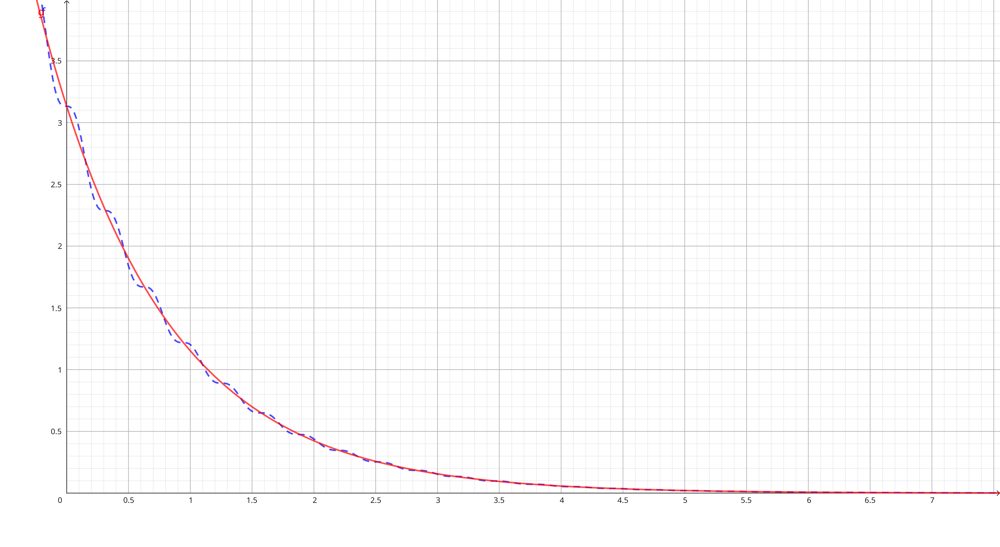
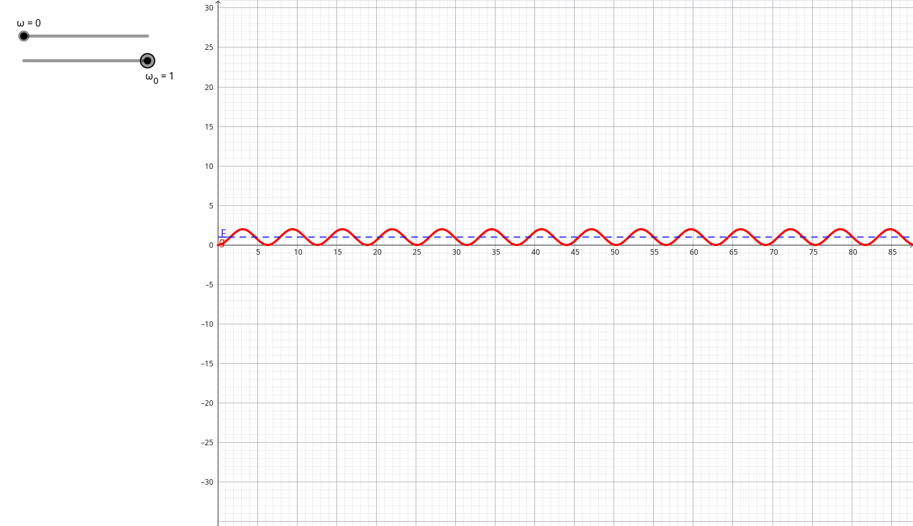
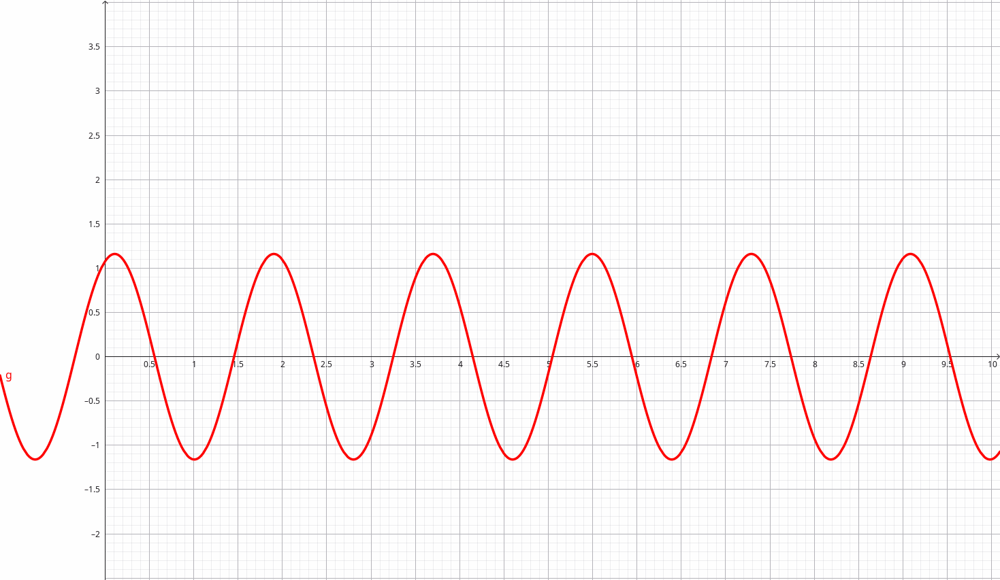
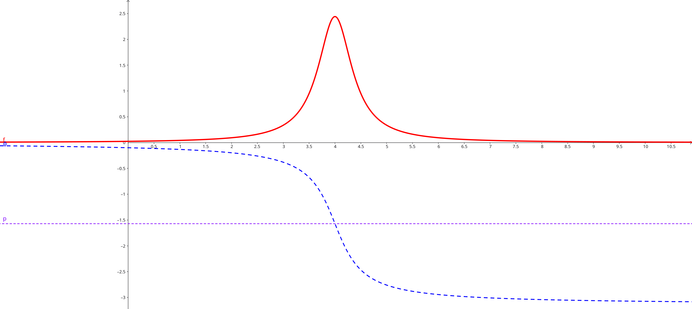
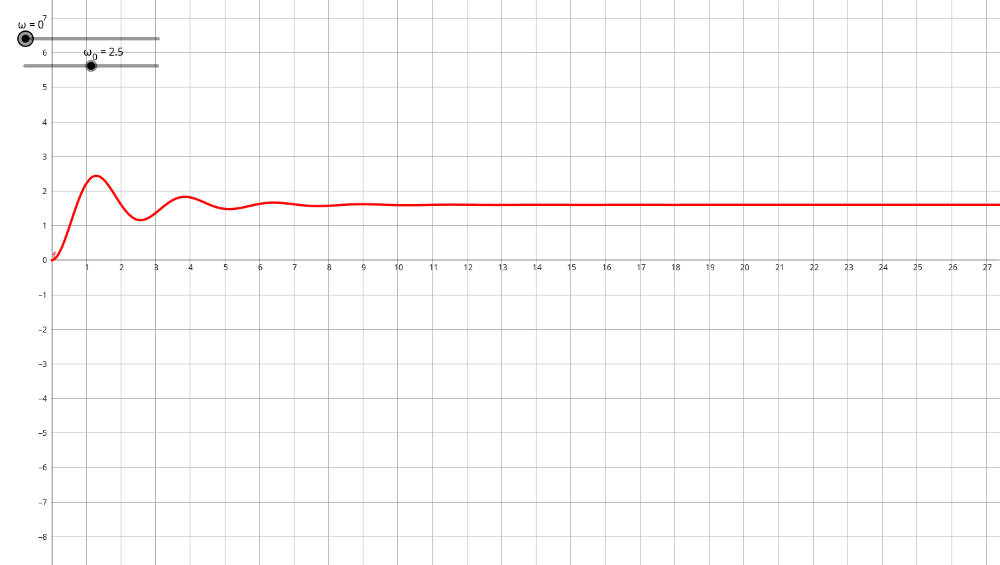
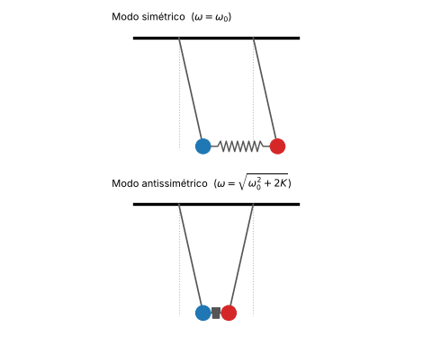
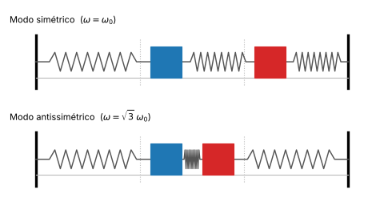
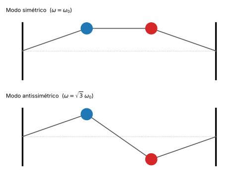

# Oscilações II 

# Oscilações amortecidas 

Podemos introduzir como motivação para o estudo das chamadas <i>oscilações amortecidas</i> a constatação de que sistemas conservativos são idealizações: na realidade, sempre haverá dissipação energética. Num pêndulo, esta dissipação surge da resistência do ar. Num fluido em oscilação, de sua própria viscosidade. 

<i>Animação comparando as oscilações de um sistema massa-mola não-amortecido (preto) e amortecido (azul). GIF sob CC-BY-SA, via <a href="https://commons.wikimedia.org/wiki/File:Damped_Spring_Simulation.gif" target="_blank">Wikimedia Commons</a>.</i>

Ao modelarmos forças dissipativas, é razoável adotar um termo linear de dissipação energética (isto é, proporcional à velocidade do móvel) para pequenos valores de $\dot{x}$ (baixas velocidades, ou baixo número de Reynolds no caso de um fluido), que corresponde às pequenas oscilações que estão dentro do escopo da física básica.

Assim, para um oscilador unidimensional, a equação de movimento assume a forma 

$$
m\ddot{x} = -kx - \rho \dot{x}
$$

com $-\rho \dot{x}$ (e $\rho \gt 0$) modelando essa resistência dissipativa. Dividindo ambos os membros por $m$, obtemos

$$
\ddot{x} + \gamma \dot{x} + \omega_0^2 x = 0
$$

com $\omega_0^2 = \dfrac{k}{m}$ e $\gamma = \dfrac{\rho}{m}$. Note que esta é uma <a href="/books/scholarium/math/calculus_two/differential_equations.html" target="_blank">equação diferencial linear homogênea de segunda ordem e coeficientes constantes</a>.

Sua equação característica é 

$$
p^2 + \gamma p + \omega_0^2 = 0
$$

cujas raízes são $p_\pm = -\dfrac{\gamma}{2} \pm \sqrt{\dfrac{\gamma^2}{4} - \omega_0^2}$. 

Há três regimes, conforme o sinal do radicando $\dfrac{\gamma^2}{4} - \omega_0^2$: o amortecimento é <i>subcrítico</i> quando $\dfrac{1}{2}\gamma \lt \omega_0$, <i>crítico</i> quando $\dfrac{1}{2}\gamma = \omega_0$ e <i>supercrítico</i> quando $\dfrac{1}{2}\gamma \gt \omega_0$. Começamos pelo caso subcrítico por ser o único em que há oscilação e, portanto, aquele que fundamenta os conceitos de envoltório, tempo de decaimento e fator de mérito, além do estudo da ressonância sob amortecimento fraco. Os outros dois regimes serão tratados em seguida.

Como há uma raiz quadrada cujo radicando é negativo, podemos reescrever as raízes da forma 

$$
\begin{align*}
    p_\pm &= -\dfrac{1}{2}\gamma \pm i\omega' \\ 
    \omega' &= \sqrt{\omega_0^2 - \dfrac{\gamma^2}{4}}
\end{align*}
$$

Para possibilitar a adaptação de nossa solução às condições iniciais, precisamos de uma solução com constantes reais arbitrárias. Tomando a combinação linear (com coeficientes complexos $c_\pm$) das soluções da equação característica, temos para o amortecimento subcrítico:

$$
z(t) = \exp\left(-\dfrac{1}{2}\gamma t\right) (c_+e^{i\omega' t} + c_-e^{-i\omega' t})
$$

Como a equação tem coeficientes reais, a parte real de uma solução complexa também é solução. Tomando a parte real, obtemos: 

$$
x(t) = \exp\left(-\dfrac{1}{2}\gamma t\right)[a\cos{(\omega' t)} + b\sin{(\omega' t)}]
$$

com $a = \Re(c_+ + c_-)$ e $b = \Im(c_- - c_+)$ constantes reais arbitrárias. Esta é a equação geral para as oscilações subcríticas, análoga a $x(t) = a\cos{(\omega t)} + b\sin{(\omega t)}$ deduzida para o oscilador harmônico (cf. <a href="/books/scholarium/physics/physics_two/oscillations.html" target="_blank">Oscilações I</a>).[^1]

Alternativamente, podemos tomar $a = A\cos{\phi}$ e $b = -A\sin{\phi}$, obtendo

$$
x(t) = A\exp\left(-\dfrac{1}{2}\gamma t\right) \cos{(\omega' t+ \phi)}
$$

cujas constantes arbitrárias são $A$ e $\phi$. Esta forma é apenas válida para o amortecimento subcrítico.

Para ajustar a solução geral às condições iniciais, basta encontrar 

$$
\dot{x}(t) = -\dfrac{1}{2}\gamma x(t) + \exp\left(-\dfrac{1}{2}\gamma t\right) [-\omega' a \sin{(\omega' t)} + \omega' b\cos{(\omega' t)}]
$$

e, consequentemente, teremos as condições iniciais: 

$$
\begin{cases}
    x(0) = x_0 = a \\ 
    \dot{x}(0) = v_0 = -\dfrac{1}{2}\gamma a + \omega' b 
\end{cases}
\implies 
b = \dfrac{1}{\omega'}\left(v_0 + \dfrac{1}{2}\gamma x_0\right)
$$

Por fim, dadas essas novas quantias, podemos reescrever a equação de movimento de uma forma alternativa: 

$$
x(t) = \exp\left(-\dfrac{1}{2}\gamma t\right)\left[x_0\cos{(\omega' t)} + \left(\dfrac{v_0}{\omega'} + \dfrac{\gamma x_0}{2\omega'}\right)\sin{(\omega' t)}\right]
$$

## Amortecimento subcrítico

Nesta subseção e nas próximas iremos realizar análises um pouco mais detalhadas dos cenários de amortecimento, dando continuidade inicialmente ao amortecimento subcrítico (quando $\dfrac{1}{2}\gamma \lt \omega_0$). 

Um oscilador em regime de amortecimento subcrítico obedece à equação de movimento 

$$
x(t) = A\exp\left(-\dfrac{1}{2}\gamma t\right)\cos(\omega' t + \phi)
$$

com o termo $A\exp\left(-\dfrac{1}{2}\gamma t\right)$ podendo ser considerado a amplitude (lentamente variável) do movimento para amortecimentos fracos, isto é, na aproximação em que $\gamma \ll \omega_0$ (e, portanto, $\omega' \approx \omega_0$). 

Além disso, as curvas $\pm A\exp\left(-\dfrac{1}{2}\gamma t\right)$ definem o chamado <b>envoltório</b> das oscilações. 

<i>Oscilações sob amortecimento subcrítico. Note o "envelope" tracejado.</i>

Mesmo que as oscilações não sejam mais periódicas, por uma certa conveniência (e falta de opção) é mantida a denominação "período" para o intervalo $\tau = \dfrac{2\pi}{\omega'}$. 

Num ponto de vista energético, é possível mostrar que para o caso de um oscilador fracamente amortecido, sua energia mecânica média decai (aproximadamente) de forma exponencial ao longo do tempo. 

Vamos começar do início.

É conhecido que a energia mecânica do oscilador no instante $t$ é

$$
E(t) = \dfrac{1}{2}m\dot{x}(t)^2 + \dfrac{1}{2}kx(t)^2
$$

Como esta grandeza não é mais conservada, podemos agora determinar sua taxa (não-nula) de variação:

$$
\dfrac{dE}{dt} = m\dot{x}\ddot{x} + kx\dot{x} = \dot{x}(m\ddot{x} + kx)
$$

Esta, no nosso caso, é equivalente (pela equação de movimento original) à equação:

$$
\dfrac{dE}{dt} = -\rho\dot{x}^2 = -m\gamma\dot{x}^2 
$$

A taxa de variação energética instantânea é proporcional ao quadrado da velocidade! Em particular, $dE/dt \leq 0$: a energia decresce monotonicamente, com "patamares" nos instantes em que $\dot{x} = 0$.

Substituindo na equação de energia os valores de $x(t)$ e $\dot{x}(t)$ previamente deduzidos, obtemos: 

$$
E(t) = \dfrac{1}{2}mA^2 e^{-\gamma t} \left[\left(\omega_0^2 + \dfrac{\gamma^2}{4}\right)\cos^2{(\omega' t+\phi)} + \omega'^2 \sin^2{(\omega' t + \phi)} + \dfrac{1}{2}\gamma \omega' \sin{[2(\omega' t + \phi)]}\right]
$$

Tomando $\gamma \ll \omega_0$, vemos que o fator $e^{-\gamma t}$ irá variar muito pouco ao longo de um período de oscilação. Logo, poderemos tratá-lo como uma constante no raciocínio que se segue. 

Como podemos encontrar o valor médio da energia mecânica durante um período? O cálculo do valor médio é conveniente pois elimina a preocupação com as oscilações (de fato, o valor real de $E(t)$ sempre oscilará em torno do valor médio). Podemos definir essa grandeza pela integral 

$$
\bar{E}(t) = \dfrac{1}{\tau}\int_{t}^{t+\tau} E(t_*) dt_*
$$

Retirando o fator exponencial do interior da integral e fazendo as substituições

$$
\begin{cases}
    \overline{\cos^2{(\omega' t + \phi)}} = \overline{\sin^2{(\omega' t + \phi)}} = \dfrac{1}{2} \\ 
    \overline{\sin[2(\omega' t + \phi)]} = 0
\end{cases}
$$

obtemos $\bar{E}(t) = \dfrac{1}{4}mA^2e^{-\gamma t}\left[\omega_0^2 + \dfrac{\gamma^2}{4} + \omega'^2\right]$ e, como $\omega_0^2 + \dfrac{\gamma^2}{4} + \omega'^2 = 2\omega_0^2$, chegamos em $\bar{E}(t) = \dfrac{1}{2}m\omega_0^2A^2e^{-\gamma t} = \bar{E}(0) \cdot e^{-\gamma t}$, que indica um decaimento exponencial da energia média do oscilador ao longo do tempo. Este resultado é aproximado, válido para $\gamma \ll \omega_0$; a energia instantânea $E(t)$, por sua vez, decresce monotonicamente em torno dessa curva.

<i>Energia mecânica de um oscilador amortecido subcriticamente ao longo do tempo. A curva vermelha é a energia mecânica média $\bar{E}(t)$, enquanto a curva pontilhada azul é a energia real $E(t)$.</i>

Como indicativa de um decaimento exponencial, é importante explicitar que $\bar{E}(t)$ é solução da equação diferencial 

$$
\dfrac{d\bar{E}}{dt} = -\gamma \bar{E}
$$

Para caracterizar este comportamento, podemos definir o chamado <b>tempo de decaimento</b> $\tau_d$, o tempo necessário para que a grandeza se reduza a $1/e$ de seu valor inicial[^2].

Isto é, vale: 

$$
\bar{E}(\tau_d) = \dfrac{1}{e}\bar{E}(0) \implies \tau_d = \dfrac{1}{\gamma}
$$

(Note que a <i>amplitude</i> do movimento, que decai como $e^{-\gamma t/2}$, leva o dobro do tempo, $2/\gamma$, para cair a $1/e$.)

Esta grandeza é apenas uma das utilizadas na análise de um decrescimento exponencial, com a outra utilizada sendo a <b>meia-vida</b>.

Definimos a meia-vida $\tau_m$ como o tempo necessário para que uma grandeza reduza-se a metade de seu valor.

Consequentemente, é possível escrever a relação entre o tempo de decaimento, a constante $\gamma$ de decaimento e a meia-vida:

$$
\tau_m = \dfrac{\ln(2)}{\gamma} = \tau_d \ln(2)
$$

Uma outra grandeza interessante para a análise do movimento submetido ao amortecimento subcrítico é o <b>fator de mérito</b>, também chamado "fator $Q$".

A origem dessa grandeza está na análise da dissipação da energia por ciclo de oscilação. A energia perdida em um ciclo é, exatamente, $\Delta \bar{E} = \bar{E}(t) - \bar{E}(t+\tau) = \bar{E}(t)\left(1 - e^{-\gamma \tau}\right)$, que para amortecimento fraco ($\gamma \tau \ll 1$) pode ser aproximada em primeira ordem por:

$$
\Delta \bar{E} \approx -\tau\left(\dfrac{d\bar{E}}{dt}\right) = \gamma \tau\bar{E}
$$

Nesta equação $\bar{E}$ é a energia mecânica média no oscilador no instante $t$ considerado, e $\Delta \bar{E} > 0$ é a energia dissipada no intervalo $[t, t + \tau]$. 

Assim, o fator de mérito é definido como a razão (multiplicada por $2\pi$) entre a quantidade de energia presente no oscilador num dado instante $t$ e a quantidade de energia dissipada por ciclo de oscilação. 

$$
Q = 2\pi \left(\dfrac{\bar{E}}{\Delta \bar{E}}\right) \approx \dfrac{2\pi}{\gamma \tau} = \dfrac{\omega'}{\gamma} \approx \dfrac{\omega_0}{\gamma}
$$

Além de facilitar o tratamento matemático, o fator $2\pi$ faz com que $Q$ possa ser lido como o ângulo de fase (em radianos) percorrido pelo oscilador durante um tempo de decaimento $\tau_d$, isto é, $Q \approx \omega_0 \tau_d$. Equivalentemente, a energia cai a $1/e$ de seu valor após $Q/2\pi$ ciclos de oscilação (a energia nunca se dissipa completamente em tempo finito). 

Dessa forma, quanto maior $Q$, menor o amortecimento por oscilação. Comparando com a equação para o decaimento exponencial da energia, ainda é possível escrever: 

$$
Q = 2\pi\left(\dfrac{\tau_d}{\tau}\right)
$$

## Amortecimento supercrítico

Para o caso do amortecimento supercrítico, isto é, quando $\dfrac{1}{2}\gamma \gt \omega_0$, podemos utilizar diretamente as raízes da equação característica (pois não há raiz com radicandos negativos) e produzir a solução geral 

$$
x(t) = \exp\left(-\dfrac{1}{2}\gamma t\right) (ae^{\beta t} + be^{-\beta t})
$$

com $\beta = \sqrt{\dfrac{\gamma^2}{4} - \omega_0^2}$. Consequentemente, temos: 

$$
x(t) = a \exp\left[-\left(\dfrac{1}{2}\gamma - \beta\right)t\right] + b\exp\left[-\left(\dfrac{1}{2}\gamma + \beta\right)t\right]
$$

Perceba que ambas as exponenciais são decrescentes (pois $\beta \lt \dfrac{1}{2}\gamma$ para $\omega_0 \gt 0$). Note ainda que como a segunda exponencial decai mais rapidamente, a tempos longos o decaimento segue a forma da primeira. O movimento não é oscilatório: a posição de equilíbrio é cruzada no máximo uma vez, e o sistema a ela se aproxima assintoticamente.

## Amortecimento crítico

Finalmente, quando o amortecimento é considerado como crítico, isto é, quando $\dfrac{1}{2}\gamma = \omega_0$, a equação característica possui uma raiz dupla $p = -\dfrac{1}{2}\gamma$, e as duas exponenciais coincidem. Para encontrar a segunda solução independente, podemos procurar soluções da forma $x(t) = u(t)\exp\left(-\dfrac{1}{2}\gamma t\right)$. Substituindo na equação de movimento, obtemos

$$
\ddot{u} + \left(\omega_0^2 - \dfrac{\gamma^2}{4}\right)u = \ddot{u} = 0 \implies u(t) = a + bt
$$

e, portanto,

$$
x(t) = \exp\left(-\dfrac{1}{2}\gamma t\right)(a + bt)
$$

Mantida fixa a frequência natural $\omega_0$, esta solução é a que mais rapidamente se aproxima do equilíbrio sem oscilar: seu decaimento assintótico tem taxa $\omega_0$, maior que a taxa $\gamma/2 \lt \omega_0$ do envoltório subcrítico e que a taxa $\dfrac{1}{2}\gamma - \beta \lt \omega_0$ do caso supercrítico. (O caso subcrítico pode cruzar o equilíbrio mais cedo, mas o ultrapassa e continua oscilando.) Consequentemente, o amortecimento crítico é amplamente utilizado em aparelhos de precisão, como balanças.

<i>Acima temos uma animação dos gráficos característicos de movimentos oscilatórios amortecidos (azul), críticos (verde) e supercríticos (vermelho). Note que os amortecidos oscilam em torno da posição de equilíbrio enquanto dela se aproximam, os críticos rapidamente se aproximam dela sem oscilar e os supercríticos também não oscilam, aproximando-se do equilíbrio mais lentamente. GIF autoral, feito pelo Geogebra, disponibilizado <a href="https://commons.wikimedia.org/wiki/File:Oscillatory_motion_(damped).gif" target="_blank">aqui</a>.</i>

## Unificação dos três regimes

Os três regimes são, na verdade, uma única família de soluções. A solução em termos das condições iniciais,

$$
x(t) = \exp\left(-\dfrac{1}{2}\gamma t\right)\left[x_0\cos{(\omega' t)} + \left(v_0 + \dfrac{\gamma x_0}{2}\right)\dfrac{\sin{(\omega' t)}}{\omega'}\right]
$$

com $\omega'^2 = \omega_0^2 - \dfrac{\gamma^2}{4}$, vale em todos os casos, desde que $\cos{(\omega' t)}$ e $\sin{(\omega' t)}/\omega'$ sejam entendidas como funções de $\omega'^2$:

- $\omega'^2 \gt 0$ (subcrítico): a forma já vista;
- $\omega'^2 \lt 0$ (supercrítico): com $\omega' = i\beta$, $\cos{(\omega' t)} \to \cosh{(\beta t)}$ e $\sin{(\omega' t)}/\omega' \to \sinh{(\beta t)}/\beta$, ambas reais;
- $\omega'^2 \to 0$ (crítico): $\cos{(\omega' t)} \to 1$ e $\sin{(\omega' t)}/\omega' \to t$, recuperando $x(t) = \exp\left(-\dfrac{1}{2}\gamma t\right)\left[x_0 + \left(v_0 + \dfrac{\gamma x_0}{2}\right)t\right]$.

O caso crítico é, portanto, o limite que separa o regime oscilatório do não-oscilatório.

# Oscilações forçadas

Anteriormente, os cenários concentraram-se em oscilações livres, isto é, aquelas produzidas por um oscilador sem nenhuma influência externa, amortecidas ou não. Daqui em diante iremos tratar de oscilações decorrentes de um oscilador que sofre a atuação de uma força externa periódica (cujo período não necessariamente coincida com o período do oscilador). A essas oscilações denominamos <b>oscilações forçadas</b>. 

Como exemplos no mundo cotidiano podemos citar as oscilações de nosso tímpano decorrente da interação com as ondas sonoras, as oscilações do diafragma de um microfone ou ainda as oscilações elétricas produzidas por aparelhos de radiodetecção ao captarem um sinal. 

Inicialmente em nossa análise, vamos considerar um oscilador não-amortecido. 

Considerando $F(t) = F_0\cos{(\omega t)}$ a força externa de frequência angular $\omega$, a equação de movimento torna-se $m\ddot{x} + kx = F_0\cos{(\omega t)}$. Podemos denominar $\omega_0 = \sqrt{\dfrac{k}{m}}$ como a frequência natural (ou própria) das oscilações livres.[^3] Substituindo nessa relação na equação de movimento, obtemos $\ddot{x} + \omega_0^2 x = \dfrac{F_0}{m}\cos({\omega t})$. 

Perceba que esta é uma EDO linear de 2ª ordem não-homogênea. O princípio da superposição vale para as soluções da equação homogênea associada, mas não para a equação completa; em seu lugar, vale uma versão adaptada: a solução geral é a soma de uma solução particular da equação não-homogênea com a solução geral da equação homogênea (cf. <a href="/books/scholarium/math/calculus_two/differential_equations.html" target="_blank">Equações Diferenciais</a>). Fisicamente, a solução geral da equação homogênea corresponde às oscilações livres que, no caso real com dissipação, decaem como $e^{-\gamma t/2}$, devendo se tornar desprezíveis para $t \gg 2\tau_d$ e desaparecer quando $t \to \infty$, restando apenas as oscilações decorrentes da força externa. Consequentemente, dizemos que a solução particular é a <b>solução estacionária</b>, alcançada depois de um tempo longo, enquanto as oscilações livres são um <b>transiente</b>. 

Mesmo que a equação de movimento obtida seja no caso em que a dissipação seja desprezível, é conveniente manter a linguagem utilizada. Assim, a solução estacionária almejada é uma solução particular da equação não-homogênea. 

A seguir, essa solução será obtida por uso de notação complexa. É visível que, tomando $z(t) = x(t) + iy(t)$, a equação de movimento é a parte real da equação complexa 

$$
\ddot{z} + \omega_0^2 z = \dfrac{F_0}{m}e^{i\omega t}
$$

de forma que é suficiente encontrar uma solução particular dessa equação e tomar sua parte real. 

É razoável esperar que a oscilação produzida pela força externa tenha a mesma frequência dessa força. Assim, procuraremos uma solução da forma $z(t) = z_0e^{i\omega t}$ (cf. última tabela de <a href="/books/scholarium/math/calculus_two/differential_equations.html" target="_blank">Equações Diferenciais</a>). Note que esta tentativa só é válida para $\omega \neq \omega_0$: em $\omega = \omega_0$ o termo forçante coincide com uma solução da equação homogênea, caso que trataremos adiante. Da solução proposta, temos $\dot{z} = i\omega z \iff \ddot{z} = -\omega^2 z$ que, ao substituir na equação original, resulta em 

$$
(\omega_0^2 - \omega^2)z = \dfrac{F_0}{m}e^{i\omega t} \implies z(t) = \dfrac{F_0}{m(\omega_0^2 - \omega^2)}e^{i\omega t} 
$$

Além disso, temos 

$$
\dfrac{F_0}{m(\omega_0^2 - \omega^2)} = Ae^{i\phi}
$$

com $A = \dfrac{F_0}{m|\omega_0^2 - \omega^2|}$ e $\phi = 0$, caso $\omega \lt \omega_0$, e $\phi = \pm \pi$, caso $\omega \gt \omega_0$. Esse último duplo sinal é possível pois $e^{\pm i\pi} = -1$ (adotaremos $\phi = -\pi$).

Tomando a parte real de $z(t)$, obtemos 

$$
x(t) = A\cos{(\omega t + \phi)}
$$

uma solução estacionária de mesma frequência que a força externa, amplitude $A$ e defasagem (em relação à força externa) $\phi$.

## Casos extremos

Quando $\omega \ll \omega_0$, o termo inercial $\ddot{x} = -\omega^2x$ é muito menor que o termo associado à força restauradora (o termo $\omega_0^2 x$). Logo, vale a aproximação

$$
\omega_0^2 x \approx \dfrac{F_0}{m}\cos{(\omega t)} \iff x \approx \dfrac{F_0}{m\omega_0^2}\cos{(\omega t)} 
$$

Ou seja, o deslocamento é no mesmo sentido da força externa (pois $\phi = 0$), que equilibra a força restauradora (isto é, $-kx + F(t) \approx 0$). Em questões de nomenclatura, o movimento é dominado pela <b>força restauradora</b> e a situação se aproxima do equilíbrio estático (isto é, $\omega \to 0$).

Quando $\omega \gg \omega_0$, o termo $\omega_0^2 x$ associado à força restauradora é desprezível frente ao termo inercial. Nessa situação, vale a aproximação

$$
-\omega^2 x \approx \dfrac{F_0}{m}\cos{(\omega t)} \implies x \approx -\dfrac{F_0}{m\omega^2}\cos{(\omega t)}
$$ 

Nota-se que o movimento está em oposição de fase ($\phi = -\pi$) e dominado pela inércia, pois a aceleração é quase totalmente decorrente da força externa. Comparando as duas equações para $x$ na aproximação de baixas e altas frequências, percebe-se que $|x|$ é muito menor para $\omega \gg \omega_0$ do que para $\omega \ll \omega_0$, com $x \to 0$ quando $\omega \to \infty$. A inércia do oscilador não permite que este acompanhe as oscilações muito rápidas da força.

Por fim, quando $\omega \to \omega_0$, a amplitude $A$ aumenta cada vez mais, tendendo ao infinito. A este fenômeno chamamos <b>ressonância</b>. Ao analisarmos a fase do movimento, vemos que esta também muda bruscamente de 0 para $-\pi$. Evidentemente essas descontinuidades apenas evidenciam que o modelo empregado deixa de valer: na ausência de dissipação, nada impede que a amplitude cresça. No caso exato $\omega = \omega_0$ a amplitude não é infinita, mas cresce linearmente com o tempo (veja abaixo); em sistemas reais, a dissipação (e, para amplitudes grandes, efeitos não-lineares) limita esse crescimento. Posteriormente, veremos que a introdução de amortecimento corrigirá as descontinuidades em ambas as grandezas.

<i>Animação das curvas de uma oscilação forçada para várias velocidades angulares da força externa. Note a amplitude cada vez maior ao final do GIF (denotando a proximidade das frequências e, portanto, de uma situação de ressonância). Animação autoral.</i>

## Condições iniciais

Como discutido anteriormente, a solução geral para o oscilador forçado não-dissipativo consiste na soma da solução particular com a solução geral do problema de oscilações livres

$$
x(t) = \dfrac{F_0}{m(\omega_0^2 - \omega^2)}\cos{(\omega t)} + B\cos{(\omega_0 t + \phi_0)}
$$

com as constantes $B$ e $\phi_0$ determinadas pelas condições iniciais. Por exemplo, quando o oscilador encontra-se inicialmente em equilíbrio (isto é, $x(0) = 0$ e $\dot{x}(0) = 0$), temos: 

$$
\begin{cases}
    x(0) = \dfrac{F_0}{m(\omega_0^2 - \omega^2)} + B\cos{\phi_0} = 0 \\ 
    \dot{x}(0) = -\omega_0B\sin{\phi_0} = 0
\end{cases}
$$

o que implica em $\phi_0 = 0$ e $B = -\dfrac{F_0}{m(\omega_0^2 - \omega^2)}$. 

Substituindo esses valores na equação original resulta em: 

$$
x(t) = -\dfrac{F_0}{m(\omega_0 + \omega)}\left[\dfrac{\cos{(\omega t)} - \cos{(\omega_0 t)}}{\omega - \omega_0}\right]
$$

Usando a identidade $\cos{(\omega t)} - \cos{(\omega_0 t)} = 2\sin\left[\dfrac{(\omega_0+\omega)t}{2}\right]\sin\left[\dfrac{(\omega_0-\omega)t}{2}\right]$, vemos que esta é a equação da superposição de dois MHS de frequência diferente, isto é, uma oscilação rápida (de frequência $(\omega_0+\omega)/2$) modulada por uma envoltória lenta (de frequência $(\omega_0-\omega)/2$): os <a href="/books/scholarium/physics/physics_two/oscillations.html" target="_blank">batimentos</a> previamente discutidos. Tomando o limite da ressonância, obtemos:

$$
\lim_{\omega \to \omega_0} \left[\dfrac{\cos{(\omega t)} - \cos{(\omega_0 t)}}{\omega - \omega_0}\right] = \left.\dfrac{d}{d\omega}\cos{(\omega t)}\right|_{\omega = \omega_0} = -t\sin{(\omega_0 t)}
$$

O que implica em $x(t) = \dfrac{F_0}{2m\omega_0}t\sin{(\omega_0 t)}$. 

Perceba que essa função satisfaz a equação diferencial adaptada com $\omega_0$ e as condições iniciais postas anteriormente (oscilador em repouso). Além disso, a amplitude da oscilação cresce linearmente com o tempo, concordando com a observação do nosso modelo que um oscilador em ressonância possui uma amplitude que tende ao infinito.

# Oscilações forçadas e amortecidas

Ao introduzir um termo dissipativo proporcional à velocidade, como feito anteriormente, a equação de movimento fica, após as transformações usuais, na forma 

$$
\ddot{x} + \gamma \dot{x} + \omega_0^2 x = \dfrac{F_0}{m}\cos{(\omega t)}
$$

Pela mesma estratégia da seção anterior, podemos encontrar uma solução particular $x(t) = \Re{z(t)}$, culminando em 

$$
z(t) = Ae^{i(\omega t + \phi)}
$$

onde 

$$
Ae^{i\phi} = z_0 = \dfrac{F_0}{m(\omega_0^2 - \omega^2 + i\gamma \omega)}
$$

Para determinarmos $A$ e $\phi$ (do número complexo $z_0$), basta utilizarmos a propriedade do quociente entre números complexos, além da definição do argumento e de sua norma: 

$$
\begin{cases}
    z_1 = F_0 / m = r_1 \in \mathbb{R} \\ 
    z_2 = \omega_0^2 - \omega^2 + i\gamma \omega = r_2e^{i\theta_2} 
\end{cases}
\implies z_0 = \dfrac{z_1}{z_2} = \dfrac{r_1}{r_2}e^{-i\theta_2}
$$

onde $r_2 = \sqrt{(\omega_0^2 - \omega^2)^2 + \gamma^2\omega^2}$ e $\theta_2$ é o argumento de $z_2$, isto é, o ângulo $\theta_2 \in (0, \pi)$ tal que $\cot{\theta_2} = \dfrac{\omega_0^2 - \omega^2}{\gamma \omega}$. (Como $\gamma\omega \gt 0$, a parte imaginária de $z_2$ é positiva, e portanto $\theta_2$ está de fato no semiplano superior.)

Consequentemente, 

$$
A^2(\omega) = \dfrac{F_0^2}{m^2[(\omega_0^2 - \omega^2)^2 + \gamma^2\omega^2]}
$$

e 

$$
\phi(\omega) = -\theta_2 = -\operatorname{arccot}{\left(\dfrac{\omega_0^2 - \omega^2}{\gamma \omega}\right)}
$$

onde adotamos para a arco-cotangente o ramo com valores em $(0, \pi)$, que é contínuo e decrescente. Assim, $\phi$ varia continuamente de $0$ (para $\omega \ll \omega_0$) a $-\pi$ (para $\omega \gg \omega_0$), passando por $\phi(\omega_0) = -\pi/2$, pois $\operatorname{arccot}(0) = \pi/2$.

Para $\omega \lt \omega_0$, isto coincide com a expressão usual $\phi = -\arctan{\left(\dfrac{\gamma \omega}{\omega_0^2 - \omega^2}\right)}$; a forma com arco-cotangente tem a vantagem de permanecer válida (e contínua) também para $\omega \gt \omega_0$.

Portanto, a solução estacionária é 

$$ 
x(t) = \Re{z(t)} = A(\omega)\cos{[\omega t + \phi(\omega)]}
$$

A introdução de efeitos de dissipação soluciona a quebra de nosso modelo vista anteriormente para o caso de ressonância. 

Consideremos o amortecimento fraco, em que $\gamma \ll \omega_0$. Quando $\gamma \to 0$, as expressões encontradas para $A$ e $\phi$ reduzem-se para as suas versões simplificadas vistas na seção de oscilações forçadas sem amortecimento, isto é, $A \to F_0/(m|\omega_0^2 - \omega^2|)$ e $\phi \to 0$ ou $-\pi$.

Consequentemente, num cenário de amortecimento fraco, é de se esperar que num estado de ressonância, a amplitude possua um máximo finito (ou seja, a assíntota anteriormente vista deixa de existir) e a fase varie rapidamente (e não mais descontínua).

Tomando $|\omega - \omega_0| \ll \omega_0$, vemos que 

$$
\omega_0^2 - \omega^2 = (\omega_0 + \omega)(\omega_0 - \omega) \approx 2\omega_0(\omega_0 - \omega)
$$

e, portanto, valem as aproximações

$$
\begin{cases}
    A^2(\omega) \approx \dfrac{F_0^2}{m^2[4\omega_0^2(\omega_0 - \omega)^2 + \gamma^2\omega_0^2]} \\ 
    \phi(\omega) \approx -\arctan{\left(\dfrac{\gamma \omega_0}{2\omega_0(\omega_0 - \omega)}\right)}
\end{cases}
$$

que se reduzem, finalmente, a

$$
\begin{cases}
    A^2(\omega) \approx \left(\dfrac{F_0}{2m\omega_0}\right)^2 \cdot \dfrac{1}{(\omega - \omega_0)^2 + \dfrac{\gamma^2}{4}} \\ 
    \phi(\omega) \approx -\dfrac{\pi}{2} + \arctan{\left(\dfrac{2(\omega_0 - \omega)}{\gamma}\right)}
\end{cases}
$$

(A expressão aproximada de $\phi$ segue de $\operatorname{arccot}(u) = \pi/2 - \arctan(u)$ com $u \approx 2(\omega_0 - \omega)/\gamma$, e por isso o arco-tangente funciona bem perto da ressonância.)

Dessas expressões é possível encontrar o valor da amplitude na ressonância: 

$$
A(\omega_0) = \dfrac{F_0}{m\omega_0 \gamma}
$$

que é, no limite de amortecimento fraco, o valor máximo da amplitude. (Exatamente, o máximo de $A$ ocorre na chamada frequência de ressonância de amplitude $\omega_R = \sqrt{\omega_0^2 - \gamma^2/2}$, com $A(\omega_R) = F_0/(m\gamma\omega')$; para $\gamma \ll \omega_0$ tem-se $\omega_R \approx \omega_0$.) Comparando com a amplitude do caso estático $A(0) = F_0/(m\omega_0^2)$, obtemos $A(\omega_0)/A(0) = \omega_0/\gamma = Q$: o fator de mérito mede o quanto a ressonância amplifica a resposta. Além disso, $A^2$ cai à metade do máximo em $\omega = \omega_0 \pm \gamma/2$, de modo que a largura total à meia altura do pico é $\Delta\omega = \gamma$ e, portanto, $Q = \omega_0/\Delta\omega$.

Abaixo temos alguns estudos animados sobre este caso.[^4]

<i>Oscilações de um oscilador amortecido para diferentes valores de $\omega$ enquanto $\omega_0$ mantém-se fixo. O pico da amplitude ocorre (aproximadamente, para amortecimento fraco) quando $\omega = \omega_0$ (ressonância).</i>

<i>Em vermelho, a amplitude de oscilação do mesmo oscilador para diferentes frequências angulares (eixo x) da força externa. Em azul, a fase do movimento (variando continuamente de 0 a $-\pi$, com valor $-\pi/2$ na ressonância). Note a mudança rápida de fase e o pico de amplitude na ressonância.</i>

## Solução geral e transiente

A solução geral do oscilador forçado e amortecido é a soma da solução estacionária com a solução geral da equação homogênea (isto é, com amortecimento mas sem força). No caso subcrítico:

$$
x(t) = A(\omega)\cos{[\omega t + \phi(\omega)]} + e^{-\gamma t/2}\left[a\cos{(\omega' t)} + b\sin{(\omega' t)}\right]
$$

Note que $A$ e $\phi$ <i>não</i> são constantes arbitrárias: são fixados por $F_0$, $\omega$, $\omega_0$ e $\gamma$. Apenas $a$ e $b$ dependem das condições iniciais:

$$
a = x_0 - A\cos{\phi}, \qquad b = \dfrac{1}{\omega'}\left(v_0 + A\omega\sin{\phi} + \dfrac{1}{2}\gamma a\right)
$$

O transiente oscila na frequência amortecida $\omega'$ (e não em $\omega_0$ ou $\omega$) e decai com o tempo; assim, a solução estacionária é independente das condições iniciais.

<i>Gráfico de $x(t)$ para uma determinada configuração, com $\omega_0$ fixo e $\omega$ variável. Perceba o transiente (correspondente à solução da equação homogênea) e a ressonância quando $\omega_0 = \omega$. GIF autoral confeccionado no Geogebra.</i>

## Energia

A potência instantânea fornecida pela força externa ao oscilador é $P(t) = F(t)\dot{x}(t)$. Na solução estacionária, $\dot{x} = -A\omega\sin{(\omega t + \phi)}$, e tomando a média em um período (usando $\overline{\cos{(\omega t)}\sin{(\omega t + \phi)}} = \tfrac{1}{2}\sin{\phi}$), obtemos

$$
\bar{P} = -\dfrac{1}{2}F_0 A\omega\sin{\phi} = \dfrac{F_0^2\gamma\omega^2}{2m[(\omega_0^2 - \omega^2)^2 + \gamma^2\omega^2]}
$$

Esta é exatamente a potência média dissipada pelo amortecimento, $m\gamma\overline{\dot{x}^2} = \tfrac{1}{2}m\gamma\omega^2A^2$: no regime estacionário, toda a energia fornecida pela força é dissipada, e a energia do oscilador permanece constante.

Perto da ressonância ($|\omega - \omega_0| \ll \omega_0$), a curva de potência é uma lorentziana:

$$
\bar{P}(\omega) \approx \dfrac{F_0^2}{2m\gamma}\cdot\dfrac{\gamma^2/4}{(\omega - \omega_0)^2 + \gamma^2/4}
$$

com máximo $\bar{P}(\omega_0) = F_0^2/(2m\gamma)$ e largura à meia altura $\Delta\omega = \gamma$, o que fecha a relação $Q = \omega_0/\Delta\omega$: quanto maior o fator de mérito, mais estreita e mais alta é a ressonância.

# Oscilações acopladas

<i>Pêndulos acoplados. GIF autoral.</i>

Imagine um sistema composto por dois pêndulos simples ligados por uma mola de constante elástica $k$. Neste sistema, a distância $d$ entre os pêndulos em equilíbrio estável é igual ao comprimento natural da mola. Inicialmente, perceba que se a massa de um pêndulo for muito maior que outra, o problema se reduzirá a um caso de oscilações forçadas — o pêndulo mais massivo forçará o pêndulo menor a oscilar na mesma frequência. 

O problema torna-se muito mais interessante ao considerarmos dois pêndulos idênticos de massa $m$ e comprimento de haste $l$. Tomando uma aproximação de pequenas oscilações, podemos considerar os deslocamentos $x_1(t)$ e $x_2(t)$ como as cordas dos arcos descritos pelos pêndulos: $x_1 \approx l\theta_1$ e $x_2 \approx l\theta_2$, com $\theta_1$ e $\theta_2$ sendo os ângulos de desvio para cada pêndulo. A deformação na mola será assim $x_2 - x_1$, produzindo uma força restauradora de módulo $k(x_2 - x_1)$ para a direita sobre o pêndulo um e $-k(x_2 - x_1)$ para a esquerda sobre o pêndulo dois.

Atuam sobre as massas forças gravitacionais de componentes tangenciais $-mg\theta_1 \approx -mgx_1/l = -m\omega_0^2 x_1$ e $-mg\theta_2 \approx -mgx_2/l = -m\omega_0^2x_2$ para as massas um e dois, respectivamente.

Desprezando qualquer efeito de amortecimento, as equações de movimento são 

$$
\begin{cases}
    m\ddot{x_1} = -m\omega_0^2 x_1 + k(x_2 - x_1) \\ 
    m\ddot{x_2} = -m\omega_0^2 x_2 - k(x_2 - x_1)
\end{cases}
$$

ou, alternativamente, 

$$
\begin{cases}
    \ddot{x_1} + \omega_0^2 x_1 = K(x_2 - x_1) \\ 
    \ddot{x_2} + \omega_0^2 x_2 = -K(x_2 - x_1)
\end{cases}
$$

ao introduzir a variável $K = k/m$. 

Note que o sistema possui dois graus de liberdade (sendo descrito por $x_1(t)$ e $x_2(t)$) e sua solução geral depende de quatro constantes arbitrárias oriundas das posições e velocidades iniciais das massas. Este sistema é dito <i>de equações acopladas</i> pois a solução de $x_1$ depende de $x_2$ e vice-versa.

No caso especial que estamos analisando podemos desacoplar as equações de forma relativamente simples. Somando membro a membro obtemos a expressão $(\ddot{x_1} + \ddot{x_2}) + \omega_0^2 (x_1 + x_2) = 0$. Por outro lado, subtraindo membro a membro, obtemos $(\ddot{x_1} - \ddot{x_2}) + \omega_0^2 (x_1 - x_2) = 2K(x_2 - x_1)$. 

Pela substituição $q_1 = \dfrac{1}{2}(x_1 + x_2)$ e $q_2 = \dfrac{1}{2}(x_1 - x_2)$, as duas equações anteriores tornam-se 

$$
\ddot{q_1} + \omega_0^2 q_1 = 0 
$$

e

$$
\ddot{q_2} + \omega_2^2 q_2 = 0
$$

com $\omega_2 = \sqrt{\omega_0^2 + 2K}$. Perceba que estas são equações de movimentos harmônicos simples. Consequentemente, temos que suas soluções gerais são 

$$
\begin{cases}
    q_1(t) = A_1 \cos{(\omega_0 t + \phi_1)} \\ 
    q_2(t) = A_2 \cos{(\omega_2 t + \phi_2)}
\end{cases}
$$

e, portanto, $x_1(t)$ e $x_2(t)$ podem ser escritas da forma

$$
\begin{cases}
    x_1(t) = q_1(t) + q_2(t) \\ 
    x_2(t) = q_1(t) - q_2(t)
\end{cases}
$$

sendo as soluções do sistema de equações acopladas cujas constantes arbitrárias são $A_1$, $\phi_1$, $A_2$ e $\phi_2$, determinadas em função das condições iniciais.

O que são $q_1$ e $q_2$ numa interpretação física? Vemos que estas duas novas coordenadas que oscilam harmonicamente (chamadas <i>coordenadas normais</i>) são, respectivamente, o deslocamento do centro de massa e um meio do deslocamento relativo entre as duas massas (isto é, $2q_2 = x_1 - x_2$). 

Dadas condições iniciais especiais, o sistema assume os chamados <b>modos normais de vibração</b>, em que os pêndulos oscilam com a mesma frequência e estão em fase ou em oposição de fase. Para um sistema com dois graus de liberdade, dois modos normais de vibração são possíveis. No primeiro, temos $A_2 = 0$ e, consequentemente, $x_1(t) = q_1(t) = A_1\cos{(\omega_0 t + \phi_1)} = x_2(t)$. Como os deslocamentos $x_1$ e $x_2$ são iguais, este é normalmente chamado <b>módulo simétrico</b>. Como a deformação da mola é nula, cada pêndulo oscila numa frequência $\omega_0$.

O segundo modo é chamado <b>modo antissimétrico</b>, de forma que $x_1(t) = -x_2(t)$ sempre. Como a força restauradora da mola soma-se à força gravitacional, a frequência de oscilação é mais elevada (\omega_2 \gt \omega_0$). 

A solução geral do sistema é uma superposição dos modos normais de vibração. Isto é, $x_1(t)$ e $x_2(t)$ são combinações lineares destes modos normais. 

No modo simétrico vemos que as condições iniciais são $x_1(0) = x_2(0)$ e $\dot{x_1}(0) = \dot{x_2} (0)$. Por outro lado, temos que para o modo antissimétrico vale $x_1(0) = -x_2(0)$ e $\dot{x_1}(0) = -\dot{x_2}(0)$. Em particular, estes oscilam no modo simétrico se $x_1(0) = x_2(0)$ e no antissimétrico se $x_1(0) = -x_2(0)$ caso partam do repouso.

Um caso interessante surge ao considerar ambos os pêndulos partindo do repouso, poré com um deles deslocado da posição de equilíbrio. 

$$
\begin{cases}
    x_1(0) = a \\ 
    x_2(0) = 0 \\ 
    \dot{x_1}(0) = \dot{x_2}(0) = 0
\end{cases}
$$

Em coordenadas normais, é equivalente escrever 

$$
\begin{cases}
    q_1(0) = q_2(0) = \dfrac{a}{2} \\ 
    \dot{q_1}(0) = \dot{q_2}(0) = 0
\end{cases}
$$

Uma consequência imediata é que $\phi_1 = \phi_2 = 0$, $A_1 = A_2 = \dfrac{a}{2}$ e 

$$
\begin{cases}
    x_1(t) = \dfrac{a}{2}[\cos{(\omega_0 t)} + \cos{(\omega_2 t)}] \\ 
    x_2(t) = \dfrac{a}{2}[\cos{(\omega_0 t) - \cos{(\omega_2 t)}}]
\end{cases}
$$

superposições de dois MHS de amplitude idêntica e frequências distintas. Pelas grandezas introduzidas na seção de batientos, escrevemos $x_1(t) = a\cos{\left(\dfrac{\Delta \omega t}{2}\right)}\cos{(\bar{\omega}t)}$ com 

$$
\begin{cases}
    \omega = \dfrac{1}{2}(\omega_2 + \omega_0) \\ 
    \Delta \omega = \omega_2 - \omega_0 = \sqrt{\omega_0^2 + 2K} - \omega_0
\end{cases}
$$

e $x_2(t) = a\sin{\left(\dfrac{\Delta \omega t}{2}\right)} \sin{(\bar{\omega} t)}$. 

Daqui consideraremos o caso em que $k \ll \omega_0^2 \iff \Delta \omega \ll \bar{\omega}$, ou seja, um caso de <i>acoplamento fraco</i>: a força restauradora que une os dois pêndulos é pequena. Note que essa configuração particular é o cenário típico dos batimentos, com $x_1(t)$ modulada por $a\cos{\left(\dfrac{\Delta \omega t}{2}\right)}$ e $x_2(t)$ modulada por $a\sin{\left(\dfrac{\Delta \omega t}{2}\right)}$. A constatação das amplitudes moduladas em quadratura é motivada pela atuação de um pêndulo sobre o outro como uma força externa. Como ambos os pênudlos possuem frequência natural $omega_0$, o processo é ressonante e provoca o crescimento rápido da amplitude de oscilação de um pêndulo e, por conservação de energia, da diminuição da amplitude de oscilação de outro. Esse comportamento leva à quadratura verificada.

<i>Massas acopladas oscilando horizontalmente. GIF autoral.</i>

Além deste sistema podemos citar outros dois que possuem em seu comportamento oscilações acopladas. Um primeiro é formado por duas massas conectadas entre si e as paredes por molas de constante elástica $k$. Nota-se que as massas movem-se apenas horizontalmente em razão da presença de uma superfície inferior ("chão") no sistema. De modo semelhante ao sistema anterior, as massas são idênticas (valendo $m$), o comprimento natural das molas é $d$ e os deslocamentos das massas são dados por $x_1(t)$ e $x_2(t)$, respectivamente. Percebe-se que há novamente dois modos normais de vibração: um simétrico, com $x_1(t) = x_2(t)$ e um antissimétrico, com $x_1(t) = -x_2(t)$.

No modo simétrico de vibração, a mola do meio não é deformada e, portanto, as partículas oscilam com frequência natural $\omega_0$, com $\omega_0^2 = k/m$. 

No modo antissimétrico, a frequência torna-se $\omega_2^2 = 3\omega_0^2$. Perceba que o sistema dos pêndulos se reduz a esse caso quando $K = \omega_0^2$. 

<i>Massas oscilando verticalmente. GIF autoral.</i>

O segundo sistema é derivado deste primero, com a configuração inicial sendo uma posição de equilíbrio com as molas igualmente tensionadas com seus comprimentos correspondendo a um espaçamento $a$. Assim, cada mola estará sujeita a uma tensão $T_0 = k(a - d)$, com cada massa sujeita a duas tensões $T_0$ e $-T_0$. Desconsiderando o "piso" introduzido na versão anterior, iremos estudar as oscilações transversais dessas massas. Realizando uma aproximação para pequenas oscilações, podemos desprezar as deformações das molas (ou seja, a tensão sempre será $T_0$) e analisar somente as componentes verticais que atuarão como forças restauradoras nas partículas. 

Dessa forma, vale que a mola esquerda exerce sobre a massa um a tensão vertical $F_1 = -T_0 \sin{\theta_1} \approx T_0 \tan{\theta_1} \approx T_0 \cdot \left(\dfrac{y_1}{a}\right)$, com $\theta_1$ sendo o ângulo entre a mola e a horizontal. Como, por hipótese, $\theta_1 \approx 0$, $\tan{\theta_1} \approx \sin{\theta_1}$. A mola mais à direita exerce, analogamente, sobre a partícula dois, uma tensão vertical $F_2 \approx -T_0 \tan{\theta_2} \approx -T_0 \left(\dfrac{y_2}{a}\right)$, com $y_2 \lt 0$. Por fim, a mola central exerce uma força restauradora $F_{12}$ sobre a partícula um e $-F_{12}$ sobre a partícula dois. 

$$
F_{12} \approx -T_0 \left(\dfrac{y_1 - y_2}{a}\right)
$$

Isso posto, as equações de movimento são: 

$$
\begin{cases}
    m_1 \ddot{y_1} = F_1 + F_{12} = -\dfrac{T_0}{a}[y_1 + (y_1 - y_2)] \\ \\
    m_2 \ddot{y_2} = F_2 - F_{12} = -\dfrac{T_0}{a}[y_2 - (y_1 - y_2)]
\end{cases}
$$

Com $\omega_0^2 = \dfrac{T_0}{ma} = K$. No modo simétrico, a mola central permanece horizontal — com $y_1 = y_2$ — com as massas oscilando numa frequência $\omega_0$. No modo antissimétrico — $y_1 = -y_2$ — a frequência de oscilação é dada por $\omega_2^2 = 3\dfrac{T_0}{ma} = 3\omega_0^2$. Perceba que desses desenvolvimentos podemos induzir que os resultados anteriores sobre modos normais podem ser aplicados a um sistema de $N$ partículas acopladas no limite de pequenas oscilações: existirão $N$ modos normais.

<i>Modos normais de um pêndulo quádruplo. Domínio público, via <a href="https://commons.wikimedia.org/wiki/File:Quadruple_pendulum_normal_modes.gif" target="_blank">Wikimedia Commons</a>.</i>

# Referências 

1. NUSSENZVEIG, Herch Moysés. Curso de física básica, v. 2: Fluidos; oscilações e ondas; calor. 4. ed. rev. São Paulo: Blucher, 2002

[^1]: Embora partamos do caso subcrítico, a solução em termos das condições iniciais pode ser escrita como $x(t) = e^{-\gamma t/2}\left[x_0\cos{(\omega' t)} + \left(v_0 + \gamma x_0/2\right)\sin{(\omega' t)}/\omega'\right]$, com $\omega'^2 = \omega_0^2 - \gamma^2/4$. Para $\omega'^2 \lt 0$ ($\omega' = i\beta$), $\cos$ e $\sin(\omega' t)/\omega'$ viram $\cosh{(\beta t)}$ e $\sinh{(\beta t)}/\beta$ (caso supercrítico). No limite $\omega' \to 0$, $\sin{(\omega' t)}/\omega' \to t$, o que recupera o caso crítico (veja a seção "Unificação dos três regimes"). Já a forma $Ae^{-\gamma t/2}\cos{(\omega' t + \phi)}$ vale apenas no caso subcrítico.

[^2]: A definição para esta grandeza torna-se mais natural ao considerarmos uma variável discreta: $\tau_d$ é o tempo médio de permanência de um elemento num conjunto caso sua quantidade de elementos esteja sujeita a um decaimento exponencial.

[^3]: Em termos simples, a "frequência natural" é a frequência com que o oscilador oscila <i>livremente</i>, isto é, na ausência de força externa. Sob a ação da força externa, a solução estacionária oscila na frequência da força.

[^4]: Embora a descontinuidade não exista para amortecimentos que não tendem à zero, o Geogebra não consegue se comportar tão bem para funções com oscilações muito violentas. O gráfico ainda mantém seu valor para o caso limite $\gamma \to 0$.