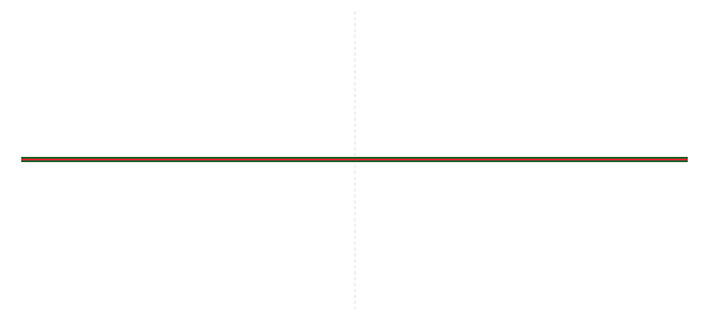

# Ondas

# Introdução

<i>"A Grande Onda de Kanagawa", famosa gravura do século XIX por Katsushika Hokusai (1760-1849). As ondas do mar são ondas mecânicas, sendo provocadas principalmente pelo vento.</i>

Podemos definir uma onda como uma perturbação no estado de equilíbrio (de alguma grandeza) que se propaga no espaço. Uma consequência dessa característica é a transmissão de energia de um ponto a outro sem a necessidade de um transporte direto de matéria. 

Diversos tipos de ondas existem, podendo elas ser mecânicas ou não. Como exemplo, podemos citar o som (uma onda mecânica), a luz (uma onda eletromagnética), as ondas sísmicas no interior da Terra ou ainda os mágnons (ondas de spin). 

Além disso, podemos classificá-las como longitudinais ou transversais. No primeiro caso, a perturbação é realizada na direção da propagação da onda. No segundo, a perturbação é realizada na direção ortogonal. Algumas ondas não são puramente longitudinais nem transversais, mas sim uma combinação dos dois tipos. Para estas, é necessário um tratamento matemático mais rebuscado que não será feito aqui.

# Ondas unidimensionais

<i>Exemplo de uma onda unidimensional progressiva. Imagem sob CC-BY-SA, sob <a href="https://commons.wikimedia.org/wiki/File:1D_Progressive_Wave.gif" target="_blank">Wikimedia Commons</a>.</i>

Inicialmente, é útil nos limitarmos a uma única dimensão pela simplicidade que esta restrição nos proporciona. Como cenário-exemplo, imagine uma perturbação viajando numa corda. Definimos o <b>perfil</b> da onda num instante $t$ como o formato da onda neste instante, dado pela função $y(x, t)$. 

Ao perturbarmos a corda, vemos que esta perturbação caracteriza-se como uma <b>onda progressiva</b> (ou <b>onda caminhante</b>), deslocando-se inteira para a direita com velocidade definida $v$ sem perder sua forma. 

Considere então um novo referencial $O'x'y'$ que coincide com $Oxy$ em $t=0$ mas viaja ao longo do eixo-x (direção da corda) na mesma velocidade $v$ da onda. Do ponto de vista desse novo referencial, o perfil da onda é invariante temporalmente, isto é: 

$$
y'(x', t) = y'(x', 0) = f'(x')
$$

Realizando uma transformação de Galileu entre os dois referenciais, 

$$
\begin{cases}
    x' = x - vt \\ 
    y' = y 
\end{cases}
$$

temos que no referencial original é válido que

$$
y(x, t) = f(x - vt)
$$

descreve uma onda progressiva que se propagada para a direita com velocidade uniforme $v$. É importante frisar o significado desta equação: $y(x, t)$ depende destas variáveis de forma que esta precisa ser uma função qualquer de $x' = x - vt$. Dessa forma, $\cos{(kx')} = \cos{(k(x-vt))}$ é uma função $y(x, t)$ válida enquanto $\cos{(kx)}$ ou $\cos{(kvt)}$ não são. 

Uma implicação direta dessa equação é que 

$$
y(x, t) = y(x + \Delta x, t + \Delta t)
$$

desde que $\Delta x = v \Delta t$. Isto é, o perfil da onda em $t + \Delta t$ é idêntico ao perfil da onda em $t$, deslocado para a direita a uma distância $\Delta x = v\Delta t$. Por simetria, basta adotar $v' = -v$ para modelar uma onda viajando no sentido oposto. 

Uma última consideração a ser feita nessa discussão inicial sobre ondas progressivas é sobre a sua direção de propagação: muitas vezes uma onda ao chegar nas extremidades será refletida, de forma que teremos ondas propagando-se em ambos os sentidos: 

$$
y(x, t) = f(x - vt) + g(x + vt)
$$

Consideraremos ondas em apenas um sentido em casos especiais como tempos curtos ou meios infinitos. 

<i>Onda harmônica viajando para a direita. GIF sob CC-BY-SA, via <a href="https://commons.wikimedia.org/wiki/File:1D-Wave.gif" target="_blank">Wikimedia Commons</a>.</i>

Um caso particular das ondas progressivas que merece atenção é o caso das <b>ondas harmônicas</b>. Em ondas harmônicas, a perturbação num ponto $x$ qualquer corresponde a um movimento harmônico simples, culminando num perfil de onda senoidal: 

$$
f(x') = A\cos{(kx' + \delta)}
$$

Consequentemente, temos que a função de onda $y(x, t)$ correspondente é da forma 

$$
y(x, t) = A\cos{[k(x-vt)+\delta]}
$$

Além disso, podemos ver que a frequência angular de oscilação num ponto $x$ é $\omega = kv = 2\pi \nu = 2 \pi / \tau$, com $\nu$ sendo a frequência e $\tau$ o período. 

Substituindo essa relação na equação anterior, obtemos: 

$$
y(x, t) = A\cos{(kx - \omega t + \delta)}
$$

<i>Diagrama ilustrando as relações entre as diferentes grandezas empregadas no estudo de ondas. Imagem sob CC-BY-SA, via <a href="https://commons.wikimedia.org/wiki/File:Commutative_diagram_of_harmonic_wave_properties.svg" target="_blank">Wikimedia Commons</a>.</i>

Perceba que uma onda desse tipo pode ser gerada numa corda, por exemplo, ao oscilar sua extremidade num movimento harmônico. Em função de $x$, $y(x, t)$ possui um perfil senoidal de período espacial $\lambda = 2\pi / k$. A essa grandeza atribuímos o nome de <b>comprimento de onda</b>, sendo a distância entre duas cristas ou dois vales. Substituindo a expressão para essa grandeza na definição da frequência angular, obtemos $\lambda = v \tau$, indicando que a onda desloca-se $\Delta x = \lambda$ num período $\Delta t = \tau$. 

Uma grandeza análoga à frequência $\nu = 1/\tau$ é o <b>número de onda</b> $\sigma = 1 / \lambda$, indicando o número de comprimentos de onda por unidade de comprimento. O análogo espacial de $\omega$, por outro lado, é o <b>número de onda angular</b> $k = 2\pi \sigma = 2\pi / \lambda$, indicando o número de radianos por unidade de comprimento. Em razão de sua maior utilização em relação a $\sigma$, a grandeza $k$ é convencionalmente chamada apenas de "número de onda". 

O argumento do cosseno ($\phi(x, t)$, explicitado abaixo) é chamado <b>fase da onda</b>, onde o número $\delta$ é a <b>constante de fase</b>. Convencionalmente, mede-se a fase em radianos, $\lambda$ em metros, o número $k$ em rad/m (ou m-1) e $\omega$ em rad/s (ou Hz). O número $A$ é a <b>amplitude</b> da onda, também mensurada em metros. 

$$
\phi(x, t) = kx - \omega t + \delta  
$$

Considere um ponto de fase constante, isso é, que $\phi(x, t) = \phi_0$. Derivando esta equação em relação ao tempo, obtemos: 

$$
\dot{\phi} = k\dot{x} - \omega = 0 \iff \dot{x} = \dfrac{\omega}{k} = v = \lambda \nu
$$

Esta expressão significa que um ponto de fase constante desloca-se na velocidade $v$ da onda. Isso motiva a nomenclatura <b>velocidade de fase</b> para $v$.

Por fim, note que podemos também escrever a expressão para uma onda harmônica empregando a notação complexa (cf. <a href="/books/scholarium/physics/physics_two/oscillations.html" target="_blank">Oscilações I</a>):

$$
y(x, t) = \Re{[Ae^{i(kx - \omega t + \phi)}]}
$$

## A equação de onda unidimensional 

Nesta seção iremos nos concentrar em associar uma equação de movimento à propagação da onda. Considere assim a expressão geral de uma onda progressiva que se propaga para a direita: 

$$
y(x, t) = f(x'), x' = x - vt
$$

Para encontrar a velocidade e a aceleração de um ponto $x$ qualquer, basta tomar derivadas parciais de $y(x, t)$, de modo que a velocidade é 

$$
\dfrac{\partial}{\partial t} y(x, t)
$$

e a aceleração é 

$$
\dfrac{\partial^2}{\partial t^2} y(x, t)
$$

Perceba que na expressão geral, $y(x, t)$ só depende de $t$ pela variável $x' = x - vt$ (isto é, a função $y(x, t)$ é uma composição de funções). Assim, pela regra da cadeia: 

$$
\dfrac{\partial y}{\partial t} = \dfrac{df}{dx'} \dfrac{\partial x'}{\partial t} = -v \dfrac{df}{dx'}
$$

Essa última igualdade foi obtida através da relação $\partial x' / \partial t = \dfrac{\partial}{\partial d}(x - vt) = -v$. 

De forma análoga, temos: 

$$
\dfrac{\partial^2 y}{\partial t^2} = -v \dfrac{\partial}{\partial t}\left(\dfrac{df}{dx'}\right) = -v \dfrac{d}{dx'} \left(\dfrac{df}{dx'}\right)\left(\dfrac{\partial x'}{\partial t}\right) = v^2 \dfrac{df^2}{dx'^2}
$$

Por outro lado, como $\partial x' / \partial x = \dfrac{\partial}{\partial x}(x - vt) = 1$, temos: 

$$
\dfrac{\partial y}{\partial x} = \dfrac{df}{dx'}\dfrac{\partial x'}{\partial x} = \dfrac{df}{dx'} \implies \dfrac{\partial^2 y}{\partial x^2} = \dfrac{d^2 f}{dx^2} \dfrac{\partial x'}{\partial x} = \dfrac{d^2 f}{dx'^2}
$$

Comparando esta equação com a anterior, vemos que $y(x, t)$ satisfaz a equação diferencial 

$$
\dfrac{1}{v^2}\dfrac{\partial^2 y}{\partial t^2} - \dfrac{\partial^2 y}{\partial x^2} = 0
$$

chamada <b>equação de onda</b> (unidimensional). Essa equação é uma das mais fundamentais da física, sendo de extrema importância em muitas situações: qualquer onda obedece a equação de onda. 

### A solução geral de d'Alembert

<i>Jean Le Rond d'Alembert em pintura datada do século XVIII. O pintor é desconhecido.</i>

Jean d'Alembert (1717-1783) foi um matemático, físico, filósofo e teórico musical francês que, dentre outros feitos, deduziu uma solução geral para a equação de onda unidimensional. Nesta seção iremos refazer seus passos, coroando a solução geral com o ajuste para condições iniciais arbitrárias. 

Considere então a equação de onda unidimensional: 

$$
\dfrac{\partial^2 y}{\partial x^2} = \dfrac{1}{v^2}\dfrac{\partial^2 y}{\partial t^2}
$$

Introduzindo as variáveis $\psi_1 = x - vt$ e $\psi_2 = x + vt$ e aplicando a regra da cadeia, obtemos: 

$$
\begin{cases}
    \dfrac{\partial}{\partial x} = \dfrac{\partial \psi_1}{\partial x}\dfrac{\partial}{\partial \psi_1} + \dfrac{\partial \psi_2}{\partial x}\dfrac{\partial}{\partial \psi_2} = \dfrac{\partial}{\partial \psi_1} + \dfrac{\partial}{\partial \psi_2} \\ 
    \dfrac{\partial}{\partial t} = \dfrac{\partial \psi_1}{\partial t}\dfrac{\partial}{\partial \psi_1} + \dfrac{\partial \psi_2}{\partial t}\dfrac{\partial}{\partial \psi_2} = -v \dfrac{\partial}{\partial \psi_1} + v \dfrac{\partial}{\partial \psi_2}
\end{cases}
$$

Assim, calculando as derivadas parciais seguidas por esses operadores, obtemos

$$
\dfrac{\partial^2 y}{\partial x^2} = \left(\dfrac{\partial}{\partial \psi_1} + \dfrac{\partial}{\partial \psi_2}\right)\left(\dfrac{\partial y}{\partial \psi_1} + \dfrac{\partial y}{\partial \psi_2}\right) = \dfrac{\partial^2 y}{\partial \psi_1^2} + 2 \dfrac{\partial^2 y}{\partial \psi_1 \partial \psi_2} + \dfrac{\partial^2 y}{\partial \psi_2^2}
$$

e

$$
\dfrac{\partial^2 y}{\partial t^2} = \left(-v\dfrac{\partial}{\partial \psi_1} + v \dfrac{\partial}{\partial \psi_2}\right)\left(-v \dfrac{\partial y}{\partial \psi_1} + v \dfrac{\partial y}{\partial \psi_2}\right) = v^2 \dfrac{\partial^2 y}{\partial \psi_1^2} - 2v^2 \dfrac{\partial^2 y}{\partial \psi_1 \partial \psi_2} + v^2 \dfrac{\partial^2 y}{\partial \psi_2^2}
$$

Substituindo estas equaçõoes na equação de onda original e reorganizando os termos, obtemos a equação diferencial parcial 

$$
\dfrac{\partial^2 y}{\partial \psi_1 \partial \psi_2} = 0
$$

que possui solução geral 

$$
y(x, t) = f(\psi_1) + g(\psi_2) = f(x - vt) + g(x + vt)
$$

onde $f$ e $g$ são funções quaisquer. Perceba então que a solução geral da equação de onda unidimensional é a soma de duas ondas progressivas: uma para a esquerda e outra para a direita. 

Considerando uma situação inicial em que $y(x, 0) = y_0(x)$ e $\dfrac{\partial y}{\partial t}(x, 0) = v_0(x)$, qual será a solução $y(x, t)$ que descreverá corretamente o comportamento da corda? 

Pelaas condições iniciais e a solução geral da equação de onda, podemos escrever 

$$
y_0(x) = f(x) + g(x)
$$

Derivando ambos os membros em relação a $t$: 

$$
v_0(x) = f'(x) \dfrac{\partial(x - vt)}{\partial t} + g'(x)\dfrac{\partial(x + vt)}{\partial t} = -v f'(x) + vg'(x)
$$

Integrando ambos os membros no intervalo $[a, x], a \in \mathbb{R}$ e simplificando: 

$$
\int_{a}^{x} v_0(s) \ ds = -v f(x) + vg(x)
$$

Assim, resolvendo o sistema de equações formado pela equação anterior e a expressão para $y_0(x)$, chegamos às expressões

$$
\begin{cases}
    f(x) = \dfrac{1}{2}y_0(x) - \dfrac{1}{2v} \int_{a}^{x} v_0(s) \ ds \\ 
    g(x) = \dfrac{1}{2}y_0(x) + \dfrac{1}{2v} \int_{a}^{x} v_0(s) \ ds
\end{cases}
$$

que, ao serem substituídas na solução geral encontrada anteriormente, produz a solução geral para as condições iniciais arbitrárias $y_0(x)$ e $v_0(x)$. 

$$
y(x, t) = \dfrac{1}{2}y_0(x - vt) + \dfrac{1}{2} y_0(x + vt) + \dfrac{1}{2v} \int_{x - vt}^{x + vt} v_0(s) \ ds
$$

# Cordas vibrantes 

<i>Câmera lenta de um violino sendo tocado. Perceba a vibração da corda. GIF sob CC-BY-SA, via <a href="https://commons.wikimedia.org/wiki/File:String_Vibration.gif" target="_blank">Wikimedia Commons</a>.</i>

Antes de discutir detalhadamente as soluções da equação de onda, é interessante atacar um primeiro exemplo de ondas mecânicas: ondas em cordas esticadas, como as encontradas em instrumentos de corda. Imagine assim uma corda unidimensional cuja posição de equilíbrio é o eixo horizontal Ox. Dessa forma, qualquer ponto $x$ está sujeito a uma tensão $-T$ para a esquerda e a uma tensão $T$ para a direita que é constante para qualquer ponto da corda. Além disso, um elemento de comprimento $\Delta x$ da corda terá a massa $\Delta m = \mu \Delta x$, com $\mu$ sendo a densidade linear da corda, uniforme. 

Limitando nossa análise a um deslocamento contido num plano Oxy, temos que qualquer ponto $x$ da corda terá um deslocamento em relação a sua posição de equilíbrio de $y(x, t)$. 

Uma imaginação muito útil para esse problema consiste em analisar a corda como um caso limite do problema de oscilações acopladas longitudinais (cf. <a href="/books/scholarium/physics/physics_two/oscillations_two.html" target="_blank">Oscilações II</a>). Assim como fizemos anteriormente, consideraremos pequenas oscilações de forma que a variaçãodo comprimento de onda seja desprezível e a magnitude $T$ da tensão permaneça constante. 

Simultaneamente, teremos que a componente $y$ da tensão no ponto $x + \Delta x$ será 

$$
T \sin{\theta} \approx T \tan{\theta} = T \dfrac{\partial y}{\partial x}
$$

com $\theta$ sendo o ângulo entre a tangente à corda e o exio horizontal. No ponto $x$ haverá uma outra força, mas na direção contrária. Assim, a força vertical resultante no comprimento de onda $\Delta x$ é 

$$
T \dfrac{\partial y}{\partial x} (x + \Delta x, t) - T\dfrac{\partial y}{\partial x}(x, t) = T\Delta x \left[\dfrac{\dfrac{\partial y}{\partial x}(x + \Delta x, t) - \dfrac{\partial y}{\partial x}(x, t)}{\Delta x}\right]
$$

com o primeiro termo sendo a força no ponto $x + \Delta x$ e o segundo termo a força no ponto $x$. Tomando $\Delta x \to 0$, a expressão se reduz para 

$$
T\dfrac{\partial^2 y}{\partial x^2}(x, t) \Delta x 
$$

Pelo princípio fundamental da dinâmica, sabemos que essa força é o produto da massa $\Delta m = \mu \Delta x$ do elemento de corda pela aceleração do elemento. Assim, a equação de movimento da corda é

$$
\mu \Delta x = \dfrac{\partial^2 y}{\partial t^2} (x, t) = T \dfrac{\partial^2 y}{\partial x^2} (x, t) \Delta x \iff \mu \dfrac{\partial^2 y}{\partial t^2}(x,t) = T \dfrac{\partial^2 y}{\partial^2 x}
$$

Note que esta é a equação de onda unidimensional ao tomar $v = \sqrt{\dfrac{T}{\mu}}$. Essa equação, a <b>equação das ondas vibrantes</b>, foi obtida por <a href="/books/hagiographia/euler.html" target="_blank">Leonhard Euler</a> e <a href="/books/hagiographia/dalembert.html" target="_blank">d'Alembert</a> em 1750. 

A expressão para a velocidade de uma onda pode ser obtida por um outro método, partindo do pressuposto que sabemos que estamos analisando ondas progressivas numa corda e, assim, buscamos determinar $v$. Suponha então um único pulso viajando por uma corda de forma que sua forma pode ser aproximada por um arco de circunferência de raio $r$ e abertura angular $2\Delta \theta \ll 1$. Tomando um outro referencial que se desloca para a direita na mesma velocidade do pulso e sabendo que as forças não se alteram numa transformação de Galileu (em razão dos referenciais serem inerciais), vemos que a força resultante sobre o elemento $\Delta l = 2r\Delta \theta$ da corda afetada pelo pulso é vertical e aponta para o centro do arco de circunferência. 

Seu módulo é: 

$$
T\sin{(\Delta \theta)} + T\sin{(\Delta \theta)} \approx 2T\Delta \theta = 2T \dfrac{\Delta l}{2r} = T\dfrac{\Delta l}{r}
$$

Além disso, em nosso novo referencial, vemos que o elemento $\Delta l$ da corda que "desliza" sobre o arco de circunferência executa um movimento circular uniforme de modo que, comparando a expressão acima com a expressão obtida pela segunda lei de Newton, obtemos: 

$$
T\dfrac{\Delta l}{r} = \Delta m \dfrac{v^2}{r} = \mu \Delta l \dfrac{v^2}{r}
$$

Perceba que essa relação implica em $v = \sqrt{\dfrac{T}{\mu}}$, como esperado.

# Intensidade de uma onda

<i>Conseguimos mensurar a intensidade do campo elétrico do Sol por todo o Sistema Solar. Astrofísicos e outros cientistas utilizam estas medições para aferir o impacto do Sol no clima terrestre. Imagem sob CC-BY-SA, via <a href="https://commons.wikimedia.org/wiki/File:Sun_in_February.jpg" target="_blank">Wikimedia Commons</a>.</i>

Definimos a intensidade de uma onda progressiva como sua potência média em relação a um período. A justificativa para tal reside na próxima natureza do fenômeno: transmissão de energia. No caso especial de uma onda mecânica numa corda, o qual estamos devotando uma atenção especial por sua simplicidade, temos que esta surge pela aplicação de trabalho sobre um elemento da corda por uma força, que se transmite ao longo do meio, gerando a onda. 

Daqui em diante seguramos alguns passos para o cálculo dessa intensidade. Considere um ponto $x$ qualquer da corda num instante $t$. É conhecido que a porção da corda à esquerda de $x$ atua sobre o elemento de corda considerado como uma força transversal: 

$$
F_y = -T \dfrac{\partial y}{\partial x} (x, t)
$$

Consequentemente, a potência realizada sobre esse elemento de corda é o produto da força $F_y$ pela sua velocidade. 

$$
P(x, t) = F_y \dfrac{\partial y}{\partial t} = -T \dfrac{\partial y}{\partial x}\dfrac{\partial y}{\partial t}
$$

No caso especial de uma onda harmônica progressiva, temos $\partial y / \partial x = -kA\sin{\phi}$ e $\partial y / \partial t = \omega A \sin{\phi}$, onde $\phi$ é a fase da onda definida anteriormente. 

$$
P(x, t) = \omega k TA^2 \sin^2{(kx - \omega t + \delta)}
$$

Note que este valor oscila tanto com o tempo tanto com $x$. Tomando o valor médio ao longo de um período (como realizando anteriormente com o <a>oscilador amortecido</a>), obtemos:

$$
I = \bar{P} = \omega kTA^2 \overline{\sin^2{(kx - \omega t + \delta)}} = \dfrac{1}{2}\omega kTA^2 = \dfrac{1}{2}\mu v \omega^2 A^2
$$

Note que a última igualdade vem do fato que $T = \mu v^2$ e $kv = \omega$, com este resultado aplicando-se apenas a este caso particular. 

Explorando um pouco mais sobre energia, podemos ver que um elemento de corda de comprimento $dx$ e massa $dm = \mu dx$ possui uma energia cinética instantânea 

$$
dT = \dfrac{1}{2}dm \left(\dfrac{\partial y}{\partial t}\right)^2 = \dfrac{1}{2}\mu \left(\dfrac{\partial y}{\partial t}\right)^2 dx
$$

que é equivalente a uma densidade de energia cinética (instantânea)

$$
\dfrac{dT}{dx} = \dfrac{1}{2}\mu \left(\dfrac{\partial y}{\partial t}\right)^2 
$$

de valor médio 

$$
\overline{\dfrac{dT}{dx}} = \dfrac{1}{4}\mu \omega^2 A^2
$$

Como cada elemento $dx$ executa um MHS na direção do eixo Oy, é conhecido que sua energia cinética média será igual a sua energia potencial média (cf. <a href="/books/scholarium/physics/physics_two/oscillations.html" target="_blank">Oscilações I</a>). Logo, vale

$$
\overline{\dfrac{dT}{dx}} = \overline{\dfrac{dU}{dx}} = \dfrac{1}{4}\mu\omega^2 A^2 \implies \overline{\dfrac{dE}{dt}} = \dfrac{1}{2}\mu \omega^2 A^2
$$

Por fim, o valor médio da energia contida num elemento $\Delta x$ da corda é $\overline{\Delta E} = \overline{\dfrac{dE}{dx}\Delta x}$. Como a onda percorre $\Delta x = v \Delta t$ num intervalo de tempo $\Delta t$, a potência média transportada é

$$
\overline{P} = \overline{\dfrac{\Delta E}{\Delta t}} = \overline{\dfrac{dE}{dt}} \left(\dfrac{\Delta x}{\Delta t}\right) = v\left(\overline{\dfrac{dE}{dx}}\right)
$$

que se reduz à expressão calculada anteriormente para $\overline{P}$. 

Comparando a densidade média de energia total da onda e a definição de intensidade, podemos interpretar esta última como o fluxo médio de energia através de um ponto qualquer da corda. 

# Interferência de ondas 

<i>Dois pulsos (vermelho e azul) viajam por uma corda (verde), interferindo no caminho.</i>

Definimos como interferência o fenômeno de encontro de duas ondas, provocando sua sobreposição. Nesta seção, iremos analisar com mais detalhes o caso particular de ondas progressivas harmônicas de mesma frequência propagando-se numa corda. 

Como primeiro cenário, considere um par de ondas

$$
\begin{cases}
    y_1(x, t) = A_1 \cos{(kx - \omega t + \delta_1)} \\ 
    y_2(x, t) = A_2 \cos{(kx - \omega t + \delta_2)}
\end{cases}
$$

propagando-se da esquerda para a direita. Como $cos{(kx - \omega t + \delta)} = \cos{(\omega t + \phi)}$ , com $\phi = -kx - \delta$, podemos deduzir a expressão

$$
y(x, t) = y_1(x, t) + y_2(x, t) = A \cos{(kx - \omega t + \delta)}
$$

para a onda resultante. Nesta nova onda, 

$$
A^2 = A_1^2 + A_2^2 + 2A_1 A_2 \cos{(\delta_{12})} 
$$

é sua amplitude, com a grandeza $\delta_{12} = \delta_2 - \delta_1$ sendo a diferença de fase entre as ondas originárias. Esta soma e posterior dedução para $A$ foi realizada por meio do método dos vetores girantes (cf. <a href="/books/scholarium/physics/physics_two/oscillations.html" target="_blank">Oscilações I</a>).

A invariância da frequência mostra que a intensidade de cada onda é proporcional ao quadrado de sau amplitude. Assim, nomeando $I_1$ e $I_2$ as intensidades das ondas originárias e $I$ a intensidade da onda resultante, temos: 

$$
I = I_1 + I_2 + 2\sqrt{I_1 I_2} \cos{(\delta_{12})}
$$

Uma consequência imediata dessa expressão é que a amplitude é máxima quando a diferença de fase é mínima, isto é, 

$$
\delta_{12} = 2m\pi \implies I = I_\text{máx} = (\sqrt{I_1} + \sqrt{I_2})^2, m \in \mathbb{Z}
$$

Pelo mesmo raciocínio, a amplitude é mínima se a diferença de fase é máxima: 

$$
\delta_{12} = (2m+1)\pi \implies I = I_\text{min} = (\sqrt{I_1} - \sqrt{I_2})^2, m \in \mathbb{Z}
$$

Em particular, se $I_1=I_2$, $I_\text{máx} = 4I = 2A_\text{máx}$ e $I_\text{min} = A_\text{min} = 0$. 

Neste segundo cenário, iremos imaginar duas ondas viajando em sentidos opostos. Suponha que estas tenham a mesma amplitude e fase: 

$$
\begin{cases}
    y_1(x, t) = A\cos{(kx - \omega t)} \\ 
    y_2(x, t) = A\cos{(kx + \omega t)}
\end{cases}
$$

Consequentemente, sua soma é dada por 

$$
y(x, t) = y_1(x, t) + y_2(x, t) = A[\cos{(kx - \omega t) + \cos{(kx + \omega t)}}] = 2A\cos{(kx)}\cos{(\omega t)}
$$

<i>Onda estacionária como superposição de duas ondas viajando em direções opostas. GIF sob CC-BY-SA, via <a href="https://commons.wikimedia.org/wiki/File:Standing_wave_2.gif" target="_blank">Wikimedia Commons</a>.</i>

Perceba que nesse caso não há propagação: o perfil da onda é estático, mudando apenas de amplitude e sinal. Ondas nesse formato são chamadas <b>estacionárias</b>. Nestas ondas especiais, os pontos de deslocamento nulo ao longo do tempo são chamados <b>nodos</b> (ou <b>nós</b>), enquanto os pontos médios entre os nodos recebem a denominação de <b>ventres</b> ou <b>antinodos</b> (alt. <b>antinós</b>). Nestes, a amplitude de oscilação é sempre máxima. Perceba ainda que os nodos subdividem a corda em partes iguais que oscilam separadamente. 

Por fim, como último cenário a ser contemplado, vamos focar no caso em que duas ondas propagam-se no mesmo sentido, mas possuem números de onda ligeiramente diferentes. Além disso, por simplicidade, vamos considerar ondas de mesma amplitude: 

$$
\begin{cases}
    y_1(x, t) = A\cos{(k_1x - \omega_1 t)} \\ 
    y_2(x, t) = A\cos{(k_2x - \omega_2 t)}
\end{cases}
$$

Conforme as discussões prévias sobre batimentos (vide <a href="/books/scholarium/physics/physics_two/oscillations_two.html" target="_blank">Oscilações I</a>), tomaremos

$$
\begin{cases}
    \Delta \omega = \omega_1 - \omega_2 \ll \bar{\omega} = \dfrac{1}{2}(\omega_1 + \omega_2) \\ 
    \Delta k = k_1 - k_2 \ll \bar{k} = \dfrac{1}{2}(k_1 + k_2)
\end{cases}
$$

supondo $\omega_1 \gt \omega_2$ e $k_1 \gt k_2$. Logo, é válido que

$$
\begin{align*}
    y(x, t) &= y_1(x, t) + y_2(x, t) \\ 
            &= A\left\{\cos{\left[\left(\bar{k} + \dfrac{\Delta k}{2}\right)x - \left(\bar{\omega} + \dfrac{\Delta \omega}{2}\right)t\right]} + \cos{\left[\left(\bar{k} - \dfrac{\Delta k}{2}\right)x - \left(\bar{\omega} - \dfrac{\Delta \omega}{2}\right)t\right]}\right\}
\end{align*}
$$

isto é, $y(x, t) = a(x, t) \cos{(\bar{k}x - \bar{\omega}t)}$, com 

$$
a(x, t) = 2A\cos{\left(\dfrac{\Delta k}{2}x - \dfrac{\Delta \omega}{2}t\right)}
$$

Como esperado, nesta configuração ocorre o fenômeno dos <b>batimentos</b>, validando a interpretação da função deduzida como uma onda de frequência $\bar{\omega}$ elevada modulada por uma onda de frequência $\Delta \omega$ bem mais baixa. Eeste é um exemplo de um grupo de ondas. Considerando a fase da $y(x, t)$ como $\phi(x, t) = \bar{k}x - \bar{\omega}t$, temos que a velocidade de fase é 

$$
v_\phi = \dfrac{\bar{\omega}}{\bar{k}}
$$

enquanto a velocidade de um grupo de ondas (apropriadamente nomeada <b>velocidade de grupo</b>) é dada por 

$$
v_y = \dfrac{\Delta \omega}{\Delta k} = \dfrac{d\omega}{dk}
$$

ao tomar $\Delta k \to 0$, com a derivada calculada em $k = \bar{k}$. Nota-se que a velocidade de grupo é a velocidado do envoltório e, portanto, de um ponto em que $a(x, t)$ é constante ao longo do tempo. Considerando uma corda vibrante e homogênea, vemos que as grandezas 

$$
\dfrac{\omega}{k} = v = \sqrt{\dfrac{T}{\mu}}
$$

são constantes de modo que as velocidades de fase e de grupo coincidem. É importante mencionar que isto nem sempre é verdade. Para alguns tipos de onda, a velocidade de fase varia com o comprimento de onda

$$
\omega = kv_\phi (k)
$$

de forma que $v_y = d\omega / dk = v_\phi = k + dv_\phi / dk \neq v_\phi$. Neste caso, dizemos que há <b>dispersão</b> da onda: é o que ocorre na luz que adentra um meio material, com seu exemplo mais famoso sendo a decomposição da luz do Sol por um prisma de vidro. As ondas menores deslocam-se em relação ao envoltório, "desaparecendo" e sendo "substituídas" por outras.

<i>Nesta animação, os pontos verdes viajam na velocidade de grupo enquanto o ponto vermelho viaja na velocidade de fase. GIF sob CC-BY-SA, via <a href="https://commons.wikimedia.org/wiki/File:Wave_group.gif" target="_blank">Wikimedia Commons</a>.</i>

# Reflexão de ondas

<i>Diagrama ilustrando o comportamento de uma onda viajando numa corda com um de seus extremos fixo. Imagem sob CC-BY-SA, via <a href="https://commons.wikimedia.org/wiki/File:Wave-pulse-reflection-fixed-end.svg" target="_blank">Wikimedia Commons</a>.</i>

Nesta seção iremos analisar alguns cenários de <b>reflexão de ondas</b>. Ondas (mecânicas ou não) podem ser refletidas quando analisamos seu comportamento na periferia do meio propagante. 

Assim, imagine uma corda horizontal sobre o eixo Ox cuja extremidade é mantida fixa no ponto O. Nesta corda propaga-se uma onda, em direção a este ponto fixo, de equação $y(x, t) = g(x + vt)$. 

Matematicamente, impomos uma <b>condição de contorno</b>, com a origem desta denominação sendo precisamente a consequência da restrição ser oriunda das extremidades do meio: 

$$
y(0, t) = 0, \forall t
$$

Substituindo esa restrição na solução geral para a equação de onda, obtemos: 

$$
y(0, t) = f(-vt) + g(vt) = 0 \implies f(-vt) = -g(vt), \forall t
$$

Perceba que como $t$ é qualquer valor real e $v$ uma constante, o produto $vt$ é um número real qualquer. É importante relembrar que $g(x, t)$ é nosso sinal conhecido enquanto $f(x, t)$ é a onda de velocidade de fase oposta que não sabemos seu comportamento e, portanto, nossa "função incógnita". Portanto, é possível determinar a "cara" de $f$.

Dado $x' in \mathbb{R}$, $f(x') = -g(-x')$. Consequentemente, $f(x - vt) = -g(vt - x)$ e a equação do problema torna-se 

$$
y(x, t) = g(vt + x) - g(vt - x)
$$

indicando uma reflexão no pulso que retorna com um deslocamento de fase igual a $\pi/2$. Esse deslocamento é consequência da necessidade de manter o ponto $O$ fixo, podendo ser visualizado ao imaginar a reflexão "viajando" por uma extensão fictícia da corda. 

<i>Diagrama ilustrando o cenário em que a extremidade é livre. Imagem sob CC-BY-SA, via <a href="https://commons.wikimedia.org/wiki/File:Wave-pulse-reflection-loose-end.svg" target="_blank">Wikimedia Commons</a>.</i>

E se a extremidade for livre ao invés de fixa? Neste cenário, despreza-se toda força transversal, considerando-se apenas a tensão $T$ da corda, suposta uniforme e horizontal pela aproximação de pequenas oscilações. A condição de contorno é, portanto,

$$
F_y(0,t) = -T\dfrac{\partial y}{\partial x}(0,t) = 0, \forall t
$$

Um arranjo experimental interessante que ilustraesse cenário é manter a extremidade livre presa a um anel de massa dessprezível que desliza sem atrito sobre um tubo vertical.[^1] 

Considere um pulso incidente na corda como o do caso da origem fixa. Substituindo a equação geral no equação de contorno, obtemos: 

$$
\dfrac{\partial y}{\partial x}(0, t) = f'(-vt) + g'(vt) = 0 \forall t 
$$

com $f'$ indicando a derivada de $f$ em relação ao argumento. 

Perceba que, por uma justificativa similar, vale

$$
f(x') = g(-x') \implies f'(x') = -g'(x'), \forall x' \in \mathbb{R}
$$

que satisfaz a equação anterior. Assim, substituindo na equação geral e fazendo a mudança $x' \to x + vt$, obtemos a expressão final: 

$$
y(x, t) = g(vt + x) + g(vt - x)
$$

Perceba que, ao contrário do cenário da extremidade fixa, a extremidade livre força a reflexão sem a mudança de fase.

<i>Comparação entre os casos de extremidade presa e extremidade livre. As ondas vermelhas são os espelhos fictícios das ondas reais, azuis, criadas pela condição de contorno. Animação em domínio público, via <a href="https://commons.wikimedia.org/wiki/File:Reflection_at_fixed_and_free_string_ends.gif" target="_blank">Wikimedia Commons</a>.</i>

# Modos normais de vibração

O problema da análise dos modos normais de vibração numa corda inextensível de comprimento $l$ pode ser interpretado como o caso limite de $N$ partículas de massa $\mu l / N$ em oscilações transversais (cf. <a href="/books/scholarium/physics/physics_two/oscillations_two.html" target="_blank">Oscilações II</a>), tomando $N \to \infty$. Essa equivalência foi demonstrada por Lagrange em 1759. 

Assim, as condições de contorno são $y(0, t) = y(l, t) = 0, \forall t$.

Note que um modo normal também se caracteriza pela oscilação de todos os pontos pela mesma frequência $\omega$ e constante de fase $\phi$. Além disso, cada elemento de corda na posição $x$ oscila com uma amplitude $A(x)$ característica do modo. Portanto, temos que a função de onda para esse cenário é 

$$
g(x, t) = A(x) \cos{(\omega t + \delta)}
$$

característica de uma onda estacionária. 

Substituindo $g(x, t)$ na solução geral da equação de onda, obtemos 

$$
\dfrac{1}{v^2} \dfrac{\partial^2 y}{\partial t^2} = -\dfrac{\omega^2}{v^2}A(x)\cos{(\omega t + \delta)} = \dfrac{\partial^2 y}{\partial x^2} = \dfrac{d^2 A}{dx^2}\cos{(\omega t + \delta)}
$$

ou, alternativamente, 

$$
\dfrac{d^2 A}{dx^2} + k^2 A = 0, k = \dfrac{\omega}{v}
$$

cuja solução geral é $A(x) = a\cos{(kx)} + b\sin{(kx)}$. Levando em conta as condições de contorno, 

$$
A(0) = a = 0 \implies A(x) = b \sin{(kx)}
$$

e, além disso, 

$$
A(l) = b\sin{(kl)} = 0, b \neq 0 
$$

Perceba que isso implica que $k$ deve assumir valores discretos $k_n$ dados por[^2]

$$
k_n = \dfrac{n\pi}{l}, n \in \mathbb{N}
$$

Assim, os valores correspondentes de $\omega = \omega_n$ são as frequências ldos modos normais de vibração:

$$
\omega_n = k_n v = \left(\dfrac{n\pi}{l}\right)v
$$

Substituindo essas questões na expressão geral encontrada, obtemos: 

$$
y(x, t) = b_n \sin{(k_nx)}\cos{(\omega_n t + \delta_n)} = b_n \sin{\left(\dfrac{n\pi}{l}x\right)} \cos{\left(\dfrac{n\pi}{l}vt + \delta_n\right)}
$$

com $n \in \mathbb{N}$. O comprimento de onda $\lambda_n$ associado ao modo $n$ é dado por 

$$
\lambda_n = \dfrac{2\pi}{k_n} = \dfrac{2l}{n}, n \in \mathbb{N}
$$

com o modo de ordem $n$ contendo $n$ semicomprimentos de onda (ventres) e $n-1$ nós, além dos extremos fixos. 

Como estamos tomando o limite $N \to \infty$ do sistema de osciladores acoplados, temos que a corda terá infinitos modos vibracionais possíveis, como evidenciado pelas equações acima. É claro que, ao tomarmos um sistema real, teremos uma limitação fundamental: o tamanho do átomo. 

A frequência $\nu_n$ do modo $n$ é

$$
\nu_n = \dfrac{\omega_n}{2\pi} = n\dfrac{v}{2l}
$$

o que implica em 

$$
\begin{cases}
    \nu_n = n\nu_1 \\ 
    \nu_1 = \dfrac{v}{2l} = \dfrac{1}{2l}\sqrt{\dfrac{T}{\mu}}
\end{cases}
$$

com $nu_1$ sendo chamada <b>frequência fundamental</b> e $\nu_n$ o <b>n-ésimo harmônico</b> desta frequência. A expressão para $nu_1$ é a expressão matemática para as <i>leis das cordas vibrantes</i> descobertas experimentalmente pelo polímata e sacerdote francês Marin Mersenne (1588-1648) e publicadas em sua obra <i>Harmonie Universelle</i> em 1636. 

<i>Série harmônica numa corda. Animação sob domínio público, via <a href="https://commons.wikimedia.org/wiki/File:Harmonic_series_on_a_string.gif" target="_blank">Wikimedia Commons</a>.</i>

## Movimento geral da corda e Joseph Fourier

Assim como visto no caso mais simples de oscilações acopladas (cf. <a href="/books/scholarium/physics/physics_two/oscillations_two.html" target="_blank">Oscilações II</a>), é possível modelar o movimento geral da onda através da combinação linear de seus modos estacionários. 

$$
y(x, t) = \sum_{n=1}^{\infty} b_n \sin{\left(\dfrac{n\pi}{l}x\right)}\cos{\left(\dfrac{n\pi}{l}vt + \delta_n\right)}
$$

Note que é possível, ao supor todos os termos da série deriváveis, encontrar uma expressão para a velocidade: 

$$
\dfrac{\partial y}{\partial t}(x, t) = -\sum_{n=1}^{\infty} \left(\dfrac{n\pi}{l}v\right)b_n \sin{\left(\dfrac{n\pi}{l}x\right)}\sin{\left(\dfrac{n\pi}{l}vt + \delta_n\right)}
$$

Para satisfazer as condições iniciais gerais, adotadas anteriormente, 

$$
\begin{cases}
    y(x, 0) = y_0(x) \\ 
    \dfrac{\partial y}{\partial t}(x, 0) = y_1(x)
\end{cases}
$$

as constantes $b$ e $\delta_n$ serão ajustadas de forma que 

$$
y(x, 0) = y_0(x) = \sum_{n=1}^{\infty} c_n \sin{\left(\dfrac{n\pi}{l}x\right)} 
$$

e

$$
\dfrac{\partial y}{\partial t}(x, 0) = y_1(x) = \sum_{n=1}^{\infty} d_n \sin{\left(\dfrac{n\pi}{l}x\right)}
$$

com $0 \le x \le l$. 

Nestas expressões, 

$$
\begin{cases}
    c_n = b_n \cos{\delta_n} \\ 
    d_n = -\dfrac{n\pi v}{l}b_n \sin{\delta_n}
\end{cases}
$$

<i>Aproximação da conhecida <b>onda triângulo</b> comum em sintetizadores por uma série de Fourier. GIF sob CC-BY-SA, via <a href="https://commons.wikimedia.org/wiki/File:Sawtooth_Fourier_Animation.gif" target="_blank">Wikimedia Commons</a>.</i>

Séries como esta são chamadas <b>séries trigonométricas</b> ou ainda <b>séries de Fourier</b>, em homenagem ao matemático francês <a href="/books/hagiographia/fourier.html" target="_blank">Joseph Fourier</a> (1768-1830) que deu sua contribuição monumental para seu estudo. Com efeito, Fourier demonstrou quqe qualquer função limitada pode ser expressa por uma série trigonométrica, com seus coeficienntes podendo ser determinados explicitamente. Em nosso caso particular, para a função $y_0(x)$, temos:[^3]

$$
c_n = \dfrac{2}{l}\int_{0}^{l} y_0(x) \sin{\left(\dfrac{n\pi}{l}x\right)} \ dx, n \in \mathbb{N}
$$

Vamos voltar à análise da função de onda como combinação linear dos modos normais. 

Perceba que, tomando um $x_0$ fixo, seu deslocamento ao longo do tempo será 

$$
y(x_0, t) = \sum_{n=1}^{\infty} B_n \cos{\left(2\pi\nu_n t + \delta_n\right)}
$$

com $nu_n$ sendo a frequência do modo $n$ e 

$$
B_n = b_n \sin{\left(\dfrac{n\pi}{l}x_0\right)}
$$

# Referências 

1. NUSSENZVEIG, Herch Moysés. Curso de física básica, v. 2: Fluidos; oscilações e ondas; calor. 4. ed. rev. São Paulo: Blucher, 2002
2. Wave. <i>Encyclopaedia Britannica</i>. Acesso em 21 de novembro de 2026. (<a href="https://www.britannica.com/science/wave-physics" target="_blank">Acesse aqui</a>)
3. d'Alembert's Solution. <i>Wolfram MathWorld</i>. Acesso em 21 de novembro de 2026. (<a href="https://mathworld.wolfram.com/dAlembertsSolution.html" target="_blank">Acesse aqui</a>)

[^1]: O simulador de ondas do PhetColorado é uma excelente ferramenta online para visualizar este e outros cenários (<a href="https://phet.colorado.edu/en/simulations/wave-on-a-string" target="_blank">Acesse aqui</a>).

[^2]: Matematicamente as soluções tem $n \in \mathbb{Z}$, entretanto, restringimos $n$ aos naturais por uma questão física e de utilidade para nossa análise. 

[^3]: A demonstração dessa expressão ainda não foi realizada aqui em razão da necessidade de um conhecimento técnico sobre séries de Fourier que o escriba ainda não possui. 